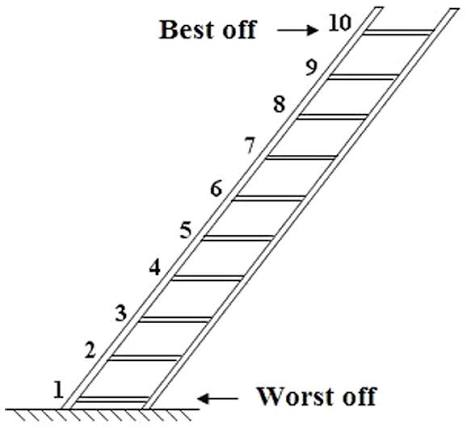
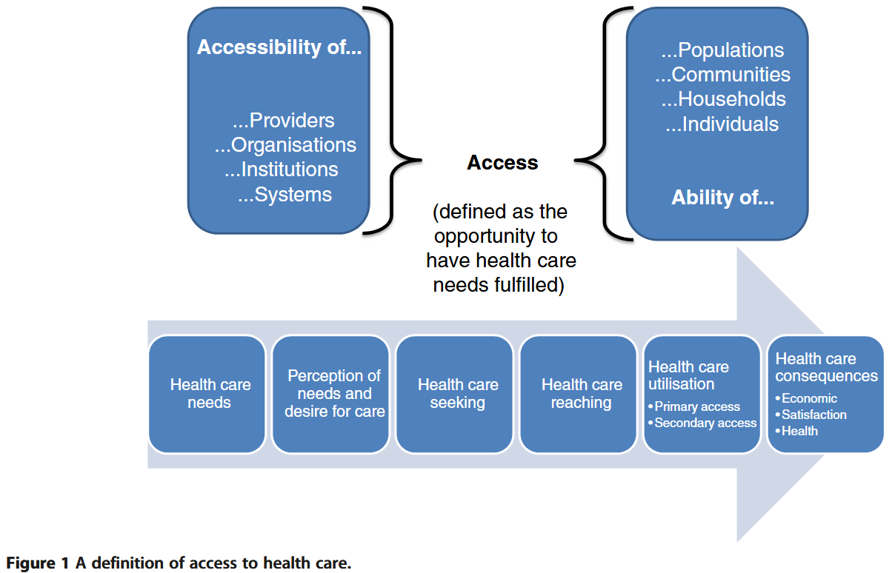
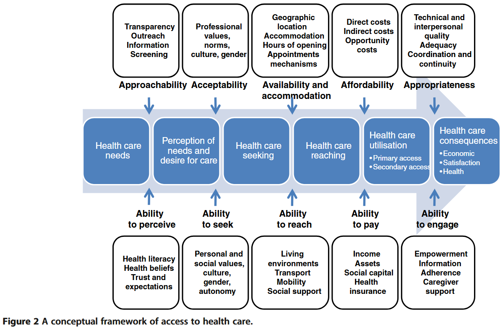

::: session-lead
Today we examine **income, social status, education and occupation** as
dimensions of socioeconomic position, before turning to **inequalities
in health care access and affordability**.

The session includes a guest talk by [**Prof. Dr. Christian Schmid, Head
of the CSS Institute**](https://www.css-institut.ch/en/ueber-uns/christian-pr-schmid/), on health care affordability and premium
subsidies.
:::

## Recap: what explains health inequalities?

In Week 5, we distinguished three pathways through which socioeconomic
disadvantage can affect health.

| Pathway | What varies socially? | Example |
|------------------------|------------------------|------------------------|
| Behavioural | Health-related practices | Smoking |
| Material | Resources and physical exposures | Income, housing and working conditions |
| Psychosocial | Stress, control and social relationships | Job strain and insecurity |

We also examined **health selection**: poor health can reduce employment
opportunities and income.

**Fundamental and structural explanations** ask why resources,
opportunities and health risks are unequally distributed in the first
place [@mccartneyWhatWhoCauses2013a].

::: {.callout-tip title="Opening question"}
A person postpones a medical consultation because they cannot afford it.

How does this example connect material circumstances, health system
arrangements and health selection?
:::

::: {.callout-note collapse="true" title="Discussion guide"}
Limited income creates a material barrier. Insurance arrangements,
treatment charges and public support shape the size of that barrier.

If postponed treatment worsens health and reduces the person's ability
to work, poor health may subsequently deepen economic disadvantage.
:::

Today we ask how socioeconomic position should be measured and how it
relates to access to health care.

## Learning objectives

By the end of this session, you should be able to:

- distinguish income, social status, education and occupation as
  dimensions of socioeconomic position;
- explain why the choice of socioeconomic indicator affects observed
  health inequalities;
- explain Levesque et al.'s distinction between the accessibility of
  services and the abilities of populations;
- distinguish health care access, use, unmet need and financial
  hardship; and
- identify suitable ISSP or ESS measures for an analysis of
  socioeconomic inequalities in health or health care access.

## Required readings

**Galobardes, B., Lynch, J., & Davey Smith, G. (2007).** Measuring
socioeconomic position in health research. *British Medical Bulletin*,
81–82(1), 21–37. <https://doi.org/10.1093/bmb/ldm001>

**Thomson, S., et al. (2024).** Monitoring progress towards universal
health coverage in Europe: A descriptive analysis of financial
protection in 40 countries. *The Lancet Regional Health – Europe, 37*,
100826. <https://doi.org/10.1016/j.lanepe.2023.100826>

**Framework used in class:** Levesque, J.-F., Harris, M. F., & Russell,
G. (2013). Patient-centred access to health care: Conceptualising access
at the interface of health systems and populations. *International
Journal for Equity in Health, 12*, 18.
<https://doi.org/10.1186/1475-9276-12-18>

## Part 1 — Socioeconomic position: a multidimensional concept

{fig-align="left" width="517"}

::: {.callout-note title="Defining socioeconomic status"}
Socioeconomic status (SES) encompasses not only income but also
educational attainment, occupational prestige, and subjective
perceptions of social status and social class. It includes
quality-of-life attributes and the opportunities afforded to people
within society, and consistently predicts a wide range of psychological
outcomes.

Adapted from the [*APA Dictionary of
Psychology*](https://dictionary.apa.org/socioeconomic-status).
:::

Socioeconomic status (SES) is considered to be a "fundamental cause" of
health inequalities.

This framework was established by Bruce G. Link and Jo C. Phelan in
their seminal 1995 paper, *"[Social Conditions as Fundamental Causes of
Disease](https://pubmed.ncbi.nlm.nih.gov/7560851/)"* (Journal of Health
and Social Behavior) [@linkSocialConditionsFundamental1995].

Link and Phelan proposed **Fundamental Cause Theory (FCT)** to solve a
major sociological puzzle: *Why does the relationship between SES and
health persist over time, even when the primary diseases, environmental
hazards, and medical treatments change completely?*

According to Link and Phelan, a social condition like SES is a
fundamental cause because it satisfies **four essential criteria**:

1.  **Influences multiple disease outcomes:** It is not tied to a single
    illness; lower SES is associated with higher rates of cardiovascular
    disease, diabetes, infectious diseases, injuries, and premature
    overall mortality.

2.  **Affects disease outcomes through multiple risk factors:** SES
    dictates exposure to a wide range of risk and protective factors
    (e.g., nutrition, housing conditions, occupational hazards, stress
    levels, and smoking rates).

3.  **Involves access to flexible resources:** High-SES individuals
    possess adaptable resources—specifically **money, knowledge,
    prestige, power, and beneficial social connections**—that can be
    deployed to avoid health risks and adopt protective strategies,
    regardless of the historical context or specific disease threat.

4.  **Reproduces the health gradient over time:** As older mechanisms
    linking SES to disease are eradicated (e.g., sanitation
    improvements, vaccines for infectious diseases), high-SES groups are
    faster to adopt new health-protective knowledge and interventions
    (e.g., smoking cessation, advanced screening, targeted
    therapeutics), continually regenerating the health inequality gap.

Hence, they define a **fundamental cause** as follows:

> *"\[A\] fundamental social cause of disease involves resources that
> determine the extent to which people are able to avoid risks for
> morbidity and mortality. Because resources are important determinants
> of risk factors, fundamental causes are linked to multiple disease
> outcomes through multiple risk-factor mechanisms. Moreover, because
> social and economic resources can be used in different ways in
> different situations, fundamental social causes have effects on
> disease even when the profile of risk factors changes radically. It
> follows that the effect of a fundamental cause cannot be explained by
> the risk factors that happen to link it to disease at any given
> time."* [@linkSocialConditionsFundamental1995, p. 88]

And they argue why they see **SES as a fundamental cause**:

> *"\[W\]e argue that social factors such as socioeconomic status and
> social support are likely "fundamental causes" of disease that,
> because they embody access to important resources, affect multiple
> disease outcomes through multiple mechanisms, and consequently
> maintain an association with disease even when intervening mechanisms
> change."* [@linkSocialConditionsFundamental1995, p. 80]

This connects to Week 5's distinction between particular pathways and
the **“causes of the causes”**.

The APA uses the term **socioeconomic status (SES)**. Following
Galobardes et al. [-@galobardesMeasuringSocioeconomicPosition2007], we
use **socioeconomic position (SEP)** as the broader organising concept
for this session. Both direct attention to several dimensions of social
advantage rather than income alone.

We can distinguish several dimensions:

1.  Income (money, material well-being, opportunities for consumption
    and saving);
2.  Social status (social prestige and recognition, subjective social
    position);
3.  Education;
4.  Occupation (occupational prestige, earnings security, job security
    and autonomy).

These dimensions overlap, but they are not interchangeable.

Galobardes et al. [-@galobardesMeasuringSocioeconomicPosition2007] argue
that using different socioeconomic indicators can reveal variation in
health inequalities and help identify the mechanisms involved.
Indicators also capture circumstances at different stages of the life
course.

::: {.callout-important title="The measurement question"}
There is no single socioeconomic indicator that is best for every
research question.

Choose an indicator because of what it measures and how it relates to
the proposed mechanism.
:::

### 1. Income

{fig-align="center"
width="467"}

Income provides material resources and opportunities for consumption and
saving. It enables people to meet basic needs, including food, housing,
heating and health care.

Distinguish two perspectives:

- **Absolute income:** the amount of resources available. Health
  benefits may be particularly substantial when additional income helps
  meet basic needs, with diminishing gains at higher incomes.
- **Relative income:** where someone stands compared with others.
  Relative disadvantage may affect health through social comparison,
  perceived status, stress and reduced control.
  - “Relative deprivation (RD) is the judgment that one is worse off
    compared to some standard accompanied by feelings of anger and
    resentment.” [@smithRelativeDeprivationTheoretical2011; @runcimanRelativeDeprivationSocial1966]

](images/clipboard-2367564528.png)

](images/clipboard-3144855622.png)

### 2. Social status

Following Max Weber, social status refers to the **social honour,
prestige or respect** accorded to an individual or group. It is
conceptually distinct from economic resources, although the two are
related.

**Subjective social position** concerns where people believe they stand
within society. This assessment may reflect income, education,
occupation and perceived recognition.

Perceived disadvantage or lack of recognition may affect health through
psychosocial pathways, including stress and reduced control.

{fig-align="center"
width="347"}

### 3. Education

Education provides qualifications, knowledge and skills. It shapes
employment opportunities and access to economic resources, while
potentially supporting health literacy and the ability to understand and
use health information.

Educational attainment also reflects earlier-life opportunities. Its
social meaning depends on the educational system and generation: the
same qualification can confer different advantages across contexts.

Education systems are often classified with [**ISCED, the International Standard Classification of Education**](https://www.uis.unesco.org/en/methods-and-tools/isced), developed by UNESCO.

](images/clipboard-4147201437.png){fig-align="center"}

### 4. Occupation

Occupation captures a person's position in the organisation of work,
including occupational prestige, earnings security, job security and
autonomy. Occupations also differ in physical hazards and psychological
demands.

Occupations are commonly coded using the [**International Standard
Classification of Occupations (ISCO)**](https://ilostat.ilo.org/methods/concepts-and-definitions/classification-occupation/). ISCO groups jobs according to
their tasks and skill requirements. These codes classify occupations
rather than placing them on a single scale of socioeconomic advantage.

ISCO codes can be translated into **theory-based occupational class or
group schemes**, such as:

- **Erikson–Goldthorpe class scheme** [@eriksonConstantFluxStudy1992; @eriksonIntergenerationalClassMobility1979]
- **European Socio-economic Classification (ESeC)** [@roseEuropeanSocioeconomicClassification2010]
- **Oesch class scheme** [@oeschRedrawingClassMap2006]

These schemes capture different aspects of social stratification,
including employment relationships and work organisation. Their
construction may require additional information, such as employment
status, supervisory responsibilities or establishment size.

#### Example: European Socio-economic Classification (ESeC)

| Class | Occupational group |
|-----------------------|-------------------------------------------------|
| 1 | Large employers and higher professionals and managers |
| 2 | Lower professionals and managers; higher technicians and supervisors |
| 3 | Intermediate occupations |
| 4 | Small employers and self-employed outside agriculture |
| 5 | Self-employed in agriculture |
| 6 | Lower supervisors and technicians |
| 7 | Lower service, sales and clerical occupations |
| 8 | Lower technical occupations |
| 9 | Routine occupations |

An additional category (10) identifies people who have never worked or
are long-term unemployed.

Source: [ESeC User
Guide](https://www.iser.essex.ac.uk/archives/esec/user-guide/the-european-socio-economic-classification),
following Rose and Harrison [-@roseEuropeanSocioeconomicClassification2010].

::: {.callout-tip title="Tools for constructing occupational class measures"}
- **R:** `DigClass` package.
- **Stata:** `iscogen` package.
- See also [Daniel Oesch’s
  website](https://people.unil.ch/danieloesch/scripts/) for
  classification scripts.
:::

We have distinguished several dimensions of socioeconomic position. We
now examine how these relate to health care access: do people with
different incomes, education and occupations have the same opportunities
to obtain care when they need it?

## Part 2 — Access to health care

Levesque et al. [-@levesquePatientcentredAccessHealth2013, fig. 1] define access as a process: the
opportunity to identify health care needs, seek services, reach them,
obtain or use care, and have the need for care fulfilled.

They place access at the interface between:

- the **accessibility of providers, organisations, institutions and
  systems**; and
- the **abilities of individuals, households, communities and
  populations**.

::: {.callout-important title="Access extends beyond the first consultation"}
A person may reach a doctor but still encounter barriers to diagnosis,
referral, treatment or follow-up.

Levesque et al. therefore include the opportunity to obtain appropriate
care and benefit from it.
:::

Levesque et al. [-@levesquePatientcentredAccessHealth2013, fig. 2] then distinguishe five dimensions of
service accessibility and five corresponding population abilities.

| Accessibility of services | Corresponding population ability | Central question |
|-------------------|-------------------|-----------------------------------|
| Approachability | Ability to perceive | Can people identify a need and recognise that relevant services exist? |
| Acceptability | Ability to seek | Can people decide to seek care that they consider acceptable? |
| Availability and accommodation | Ability to reach | Can people reach an appropriate service at a suitable time? |
| Affordability | Ability to pay | Can people bear the costs of obtaining care? |
| Appropriateness | Ability to engage | Does care meet people's needs and enable their involvement? |

### 1. Approachability and ability to perceive

**Approachability** concerns whether people can identify that services
exist, can be reached and may help them.

Relevant service characteristics include transparency, information,
outreach and screening.

The corresponding **ability to perceive** depends on health literacy,
health beliefs, trust and expectations.

**Example:** Screening is available, but information does not reach some
groups or is difficult to understand.

### 2. Acceptability and ability to seek

**Acceptability** concerns social and cultural features of services,
including professional norms, values and the characteristics of
providers.

The **ability to seek** concerns autonomy, knowledge of options and the
capacity to express a decision to obtain care.

**Example:** Someone avoids seeking care because they anticipate
disrespect or discrimination.

### 3. Availability and accommodation, and ability to reach

**Availability and accommodation** concern whether services exist in
sufficient capacity and can be reached physically and in a timely
manner.

Relevant features include location, opening hours, appointment
arrangements and building accessibility.

The **ability to reach** depends on mobility, transport, living
circumstances and social support.

**Example:** A clinic exists nearby, but its opening hours conflict with
a worker's inflexible shifts.

### 4. Affordability and ability to pay

**Affordability** concerns the resources and time required to obtain
appropriate services.

Levesque et al. distinguish:

- direct costs, such as treatment charges;
- indirect costs, such as travel expenses; and
- opportunity costs, such as lost earnings.

The **ability to pay** depends on income, assets, social capital and
health insurance.

**Example:** Someone can pay for the consultation but cannot afford the
combined treatment costs, transport and time away from work.

### 5. Appropriateness and ability to engage

**Appropriateness** concerns the fit between services and people's
needs, including timeliness, technical and interpersonal quality,
coordination and continuity.

The **ability to engage** concerns participation in decisions and
treatment. Relevant factors include information, empowerment and support
from caregivers.

**Example:** A patient obtains treatment but receives instructions they
cannot understand and no support for follow-up.

::: {.callout-note title="The dimensions interact"}
The five pairs organise the framework, but they are not independent
compartments.

A distant service can create both transport difficulties and financial
costs. Poor communication can affect the recognition of need, trust and
engagement.

Barriers may accumulate throughout the care process.
:::

### Discussion: where do we expect the largest inequalities?

::: {.callout-tip title="Discussion"}
In which of the five dimensions do you expect the largest socioeconomic
inequalities?

Choose one dimension and identify:

1.  A service characteristic.
2.  A corresponding population ability.
3.  A policy that could improve their fit.
:::

::: {.callout-note collapse="true" title="Discussion guide"}
Examples include:

- **Approachability:** accessible information and outreach alongside
  support for health literacy.
- **Availability and accommodation:** appointment arrangements that
  accommodate people with inflexible working hours.
- **Affordability:** lower charges or stronger financial protection for
  households with limited resources.
- **Appropriateness:** clear communication, coordinated care and support
  for participation in treatment.

The framework directs attention to how services respond to people's
circumstances. It should not be interpreted as attributing access
problems solely to individual deficits.
:::

Affordability is one dimension of health care access. We examine it in
more detail because the same costs can create different barriers
depending on a household's resources.

### Financial protection: hardship and unmet need

Thomson et al. [-@thomsonMonitoringProgressUniversal2024] examine whether people can obtain needed health
care without compromising their ability to meet other basic needs.

Their analysis brings together two outcomes:

- **Financial hardship:** people use health services, but out-of-pocket
  payments impoverish them or absorb a substantial share of their
  available resources.
- **Unmet need:** people forgo needed care because of financial or other
  barriers.

These outcomes must be examined together. Low health spending does not
necessarily indicate good financial protection: people may spend little
because they cannot afford treatment.

Key findings from Thomson et al. [-@thomsonMonitoringProgressUniversal2024] relevant to our session:

- Financial hardship is concentrated among poorer households.

- Outpatient medicines are a particularly important source of hardship
  for these households.

- Dental care illustrates why expenditure and unmet need can show
  different patterns: poorer people may forgo services that better-off
  people obtain and pay for.

The policy question therefore extends beyond whether people are insured.
It concerns who is entitled to care, which services are covered, and
which payments patients must make.

The guest talk by [Prof. Dr. Christian Schmid, Head of the CSS Institute](https://www.css-institut.ch/en/ueber-uns/christian-pr-schmid/),
examines this relationship in Switzerland, focusing on health care
affordability and premium subsidies.

## Applied part: SES and health care access in ESS and ISSP

The ESS and ISSP provide measures of socioeconomic position, health care
use and reported barriers to obtaining care. Their coverage differs:
some concepts have direct measures, while others can only be
approximated.

The overview below refers to **ESS Rounds 7 and 11** and the **ISSP
Health and Health Care modules from 2011 and 2021**. Check the
documentation for the selected release before combining countries or
waves.

### 1. Socioeconomic position

| Indicator | ESS | ISSP |
|------------------------|------------------------|------------------------|
| Educational attainment | `eisced`: harmonised educational level; country-specific qualifications also available | `ISCED`, `EDULEVEL`: harmonised educational level; country-specific qualifications also available |
| Years of education | `eduyrs` | `EDUCYRS` |
| Household income | `hinctnta`: household income decile within the national distribution | Country-specific household-income variables (`AT_INC`, `CH_INC`, etc.) |
| Personal income | No equivalent standard measure in this overview | Country-specific personal-income variables (`AT_RINC`, `CH_RINC`, etc.) |
| Subjective income situation | `hincfel`: feelings about household income nowadays | No directly equivalent standard background item |
| Occupation | `isco08`: ISCO-08 occupational code | `ISCO08`: ISCO-08 occupational code |
| Employment circumstances | Variables on employment status, employment relations and supervisory responsibilities | Background variables on employment status, self-employment and supervisory responsibilities |
| Subjective social position | No equivalent standard top–bottom ladder in the core questionnaire | `TOPBOT`: subjective placement from the bottom to the top of society |

### 2. Health care access and use

| Concept | ESS | ISSP |
|------------------------|------------------------|------------------------|
| Use of medical services | `dshltgp` and `dshltms`: discussion of health with a GP or specialist in the previous 12 months | Questions on frequency of visits to or by a doctor |
| Use of specific treatments | `trhltacu` Acupuncture, `trhltacp` Acupressure, `trhltcm` Chinese medicine, `trhltch` Chiropractic, `trhlt...` etc. | NA |
| Unmet need | `medtrun`: unable to obtain a needed medical consultation or treatment in the previous 12 months (1=yes, 2=no) | Questions on not receiving needed treatment for specified reasons |
| Financial barrier | `medtrnp`: reason: could not pay | Q20a in 2011; Q18a in 2021 |
| Work or other commitments | `medtrnt`: reason: could not take time off work; `medtroc`: other commitments | Q20b in 2011; Q18b in 2021 |
| Waiting times | `medtrwl`: reason: waiting list too long; `medtrnaa`: reason: no appointments available | Q20c in 2011; Q18c in 2021 |
| Geographical availability | `medtrnl`: reason: services not available where you live | NA |

### Documentation

- [ESS Data Portal](https://www.europeansocialsurvey.org/data-portal)
- [ISSP Health and Health Care
  documentation](https://www.gesis.org/en/issp/data-and-documentation/health-and-health-care)

## What have we learned?

Income, subjective social position, education and occupation capture
different dimensions of socioeconomic advantage.

Levesque et al. conceptualise access as the interaction between service
accessibility and population abilities throughout the care process.
Access extends from recognising a need to obtaining appropriate care and
benefiting from it.

Affordability is one key dimension of access. Financial protection
requires attention both to care people forgo and to the financial
consequences of care they receive.

## Outlook next week

- **Horizontal health inequalities:** gender, ethnicity, racialisation
  and migration status, and how they differ from socioeconomic position.
- **Explanations:** discrimination and structural racism, and their
  intersection with socioeconomic disadvantage.
- **Empirical application:** ESS/ISSP indicators of migration background
  and ethnic group membership; comparing health inequalities before and
  after accounting for socioeconomic position.
