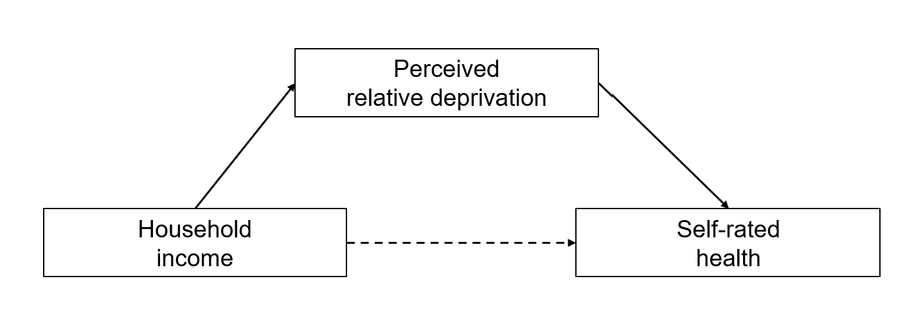
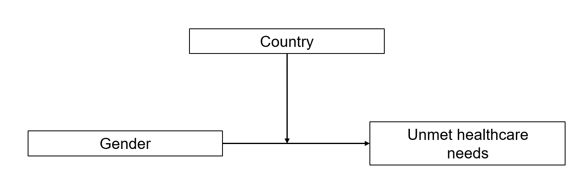
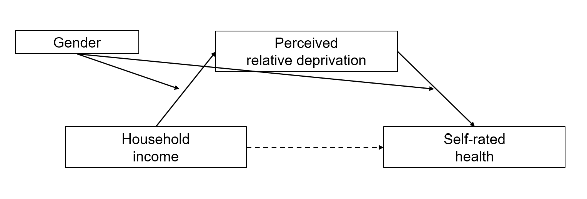

::: session-lead
Why do health outcomes differ between women and men, between people with
different migration histories, and between racialised groups? And how do
these inequalities intersect with socioeconomic position?
:::

Today we move from **vertical to horizontal health inequalities**,
examining gender, migration, race and ethnicity. We use Gkiouleka and
Huijts (2020) to illustrate how an intersectional perspective can reveal
inequalities that average group comparisons overlook.

In the second part, we focus on **your empirical research papers**:
research questions, structure, assessment criteria, accurate referencing
and statistical approaches to mediation and moderation.

**Learning objectives:** By the end of today's session, you should be
able to distinguish key concepts related to gender, migration and
racialisation; explain mechanisms behind horizontal health inequalities;
interpret intersectional evidence; and understand the expectations and
methodological options for your empirical research paper.

::: {.callout-note collapse="true"}
### Mandatory reading

**Gkiouleka, A., & Huijts, T. (2020).** Intersectional migration-related
health inequalities in Europe: Exploring the role of migrant generation,
occupational status & gender. *Social Science & Medicine, 267*, 113218.
[Read the article](https://doi.org/10.1016/j.socscimed.2020.113218).

As you read, pay particular attention to **Tables 1, 3 and 5** and the
authors' discussion of what an intersectional analysis reveals that an
average migrant/non-migrant comparison misses.
:::

## Recap: Last week's session

Last week, we examined **socioeconomic inequalities in healthcare
access**, focusing on how income, education and social status shape
people's opportunities to obtain healthcare. We also discussed barriers
to access, including financial and institutional factors.

In his guest lecture, **Christian Schmid** provided a perspective on
healthcare access and inequalities in practice.

Today we broaden the perspective: socioeconomic inequalities remain
important, but health opportunities also differ according to gender,
migration history and racialisation — often in ways that intersect with
socioeconomic position.

## From vertical to horizontal health inequalities

So far, we have mainly examined **vertical health inequalities**:
differences structured by socioeconomic position, including income,
education, and occupation.

We now turn to **horizontal health inequalities**, focusing on gender,
migration status, race, and ethnicity.

```{=html}
<div style="max-width:760px; margin:2rem auto;">

<svg viewBox="0 0 760 490" width="100%"
     xmlns="http://www.w3.org/2000/svg"
     role="img"
     aria-label="Vertical and horizontal health inequalities">

<defs>
<marker id="v8-up" markerWidth="8" markerHeight="8"
        refX="4" refY="4" orient="auto-start-reverse">
  <path d="M0 0 L8 4 L0 8 Z" fill="#b51f2e"/>
</marker>
<marker id="v8-h" markerWidth="8" markerHeight="8"
          refX="4" refY="4" orient="auto-start-reverse">
    <path d="M0 0 L8 4 L0 8 Z" fill="#426b93"/>
  </marker>
</defs>

<!-- Society pyramid -->
<path d="M380 82 L94 417 L666 417 Z"
      stroke="#b51f2e" stroke-width="2.5"
      fill="#b51f2e" fill-opacity=".035"/>

<!-- Vertical inequalities -->
<path d="M380 389 L380 113"
      stroke="#b51f2e" stroke-width="2.5"
      marker-start="url(#v8-up)"
      marker-end="url(#v8-up)"/>
      
<path d="M335 157 L335 396 M425 157 L425 396"
      stroke="#b51f2e" stroke-width="1.5"
      stroke-dasharray="5 6" opacity=".45"/>

<!-- Horizontal inequalities -->
<g stroke="#426b93" stroke-width="2.5"
   marker-start="url(#v8-h)"
   marker-end="url(#v8-h)">
  <path d="M280 220 L480 220"/>
  <path d="M220 298 L540 298"/>
  <path d="M170 370 L590 370"/>
</g>

<!-- Vertical inequalities box -->
<rect x="268" y="10" width="224" height="39"
      rx="6" fill="#b51f2e"/>
<text x="380" y="35" text-anchor="middle"
      font-size="16" font-weight="600" fill="white">
  Vertical inequalities
</text>

<text x="380" y="66" text-anchor="middle"
      font-size="13" fill="#555">
  Income/wealth · education · occupation · social status
</text>

<!-- Horizontal inequalities box -->
<rect x="12" y="136" width="218" height="39"
      rx="6" fill="#426b93"/>
<text x="121" y="161" text-anchor="middle"
      font-size="16" font-weight="600" fill="white">
  Horizontal inequalities
</text>

<!-- Horizontal inequality labels -->
<g fill="#426b93" font-size="14" font-weight="600">
  <text x="112" y="225">Gender</text>
  <text x="65" y="303">Migration status</text>
  <text x="28" y="375">Race / ethnicity</text>
</g>

<!-- Footer -->
<text x="380" y="448" text-anchor="middle"
      font-size="16" font-weight="600" fill="#333">
  Society
</text>

<text x="380" y="471" text-anchor="middle"
      font-size="13" fill="#666">
  Horizontal and vertical inequalities intersect
</text>

</svg>
</div>
```

::: text-center
<small>Source: Own illustration.</small>
:::

The distinction is useful, but horizontal and vertical inequalities are
not independent. Gender, migration status, and ethnicity often interact
with socioeconomic position in shaping health outcomes.

This intersection is a central theme of today's session.

## 1. Gender, sex and health inequalities

Before we discuss health inequalities, it is useful to distinguish
between **sex** and **gender**. The two are related, but they are not
the same.

::::::: columns
:::: {.column width="48%"}
::: {.callout-note appearance="simple"}
## Sex

**Sex** refers to biological attributes, including chromosomes,
reproductive anatomy, hormones, and sex-linked physiology.

In health research, sex matters because biological differences can
shape:

- disease risk
- symptoms and clinical presentation
- pharmacological responses
- treatment effects
:::
::::

:::: {.column width="48%"}
::: {.callout-note appearance="simple"}
## Gender

**Gender** refers to socially constructed roles, norms, identities, and
expectations associated with femininity, masculinity, and other gendered
positions.

In health research, gender matters because it shapes:

- health behaviours
- exposure to stress and risk
- help-seeking behaviour
- interactions with health professionals
- access to care and treatment decisions
:::
::::
:::::::

Sex and gender are analytically distinct, but in practice they often
interact. Biological processes can shape behaviour, while social and
gendered experiences can themselves affect biology and health.


::: {style="height: 2.5rem;"}
:::

The key message of the figure is that **sex and gender are deeply
interrelated**. Biological sex influences disease processes and
treatment responses, while gender shapes behaviour, stress exposure,
care-seeking, and providers’ decisions. At the same time, gendered
experiences can also affect biology, for example through stress or
health-related behaviour.

::: {style="height: 1.5rem;"}
:::

### The gender health paradox

A long-standing observation is that **women tend to live longer, whereas
they often report worse health and spend a larger share of their lives
with illness or limitations**. This is sometimes summarised as “women
get sicker, men die quicker” [e.g.,
@macintyreGenderDifferencesHealth1996; @bambraCOVID19GenderHealth2021;
@bartleyHealthInequalityIntroduction2025, chap. 8]. The pattern varies
by age, setting and outcome; it is not a universal rule for every
disease.

| Outcome considered | Typical pattern in many European populations | Why the distinction matters |
|------------------------|------------------------|------------------------|
| Life expectancy / mortality | Female advantage in survival | Men have higher mortality for many major causes of death |
| Self-rated health, pain or disability | Female disadvantage in several measures | Living longer does not necessarily mean living longer in good health |
| Specific diagnoses and treatments | Depends on the condition | Incidence, diagnosis, treatment and survival should be analysed separately |

::: {style="height: 2.5rem;"}
:::

Building on our earlier session on theories of health inequality, we can
distinguish several possible explanations and pathways:

- **Biological explanations:** Genetic, epigenetic and hormonal
  differences influence physiology, disease risks and treatment
  responses.
- **Behavioural explanations:** Gender norms shape health-related
  behaviours, such as smoking, alcohol consumption, diet and
  help-seeking.
- **Material explanations:** Gender differences in income, employment,
  working conditions and unpaid care responsibilities affect health.
- **Psychosocial explanations:** Unequal autonomy, power, social
  relationships and experiences of discrimination may produce
  differences in stress and health.

These explanations are not mutually exclusive. Biological and social
processes interact, and gender inequalities may also arise through
differences in diagnosis and treatment within the healthcare system.

::: {style="height: 1.5rem;"}
:::

::: {.callout-note appearance="simple"}
## Gender inequalities in Swiss healthcare

A [2024 report by the Swiss Federal
Council](https://www.bag.admin.ch/de/gesundheitliche-benachteiligung-von-frauen)
identifies persistent gender inequalities in Switzerland's healthcare
system, despite its generally high quality.

Key problems include:

- **Medical research:** Women remain underrepresented in clinical
  research, and many conditions affecting women are insufficiently
  studied.
- **Diagnosis:** Diseases affecting women are sometimes diagnosed later,
  and gender-specific symptoms may be overlooked.
- **Treatment:** Women may receive less appropriate or less intensive
  treatment, potentially contributing to poorer outcomes.
- **Knowledge gaps:** Sex- and gender-specific evidence is not
  consistently incorporated into medical education and clinical
  practice.

**A concrete example:** A [Swiss study of cardiac arrest
patients](https://www.srf.ch/wissen/gesundheit/gendermedizin-warum-frauen-oefter-an-herzstillstand-sterben)
found that women were less likely to be admitted to intensive care and
received less intensive treatment. Differences in age and comorbidities
partly complicate the interpretation of these findings.

**Policy response:** The Swiss National Research Programme [**"Gender
Medicine and Health" (NRP 83)**](https://www.nfp83.ch/en), with a budget
of CHF 11 million, aims to improve the evidence base on biological and
social aspects of gender in health and healthcare.
:::

### Beyond binary measures

Many large surveys and administrative datasets have historically used
binary sex/gender measures. Such variables are often useful for
reproducing earlier analyses, but **they do not fully capture gender
identity or the experiences of trans and non-binary people**.

A recent systematic review documents substantial health inequalities
affecting transgender and gender-diverse populations, including
disparities in physical and mental health
[@scheimHealthStatusTransgender2024].

**Swiss research** documents substantial health inequalities affecting
LGBT people, particularly in mental health: LGB respondents were around
four times as likely to report a lifetime suicide attempt as the general
population, with trans and non-binary people facing especially
pronounced disadvantages. LGBT respondents also reported frequent
discrimination, including in healthcare (26.6%), and were more than
twice as likely to forgo medical care because of a lack of trust in
healthcare providers (16.2% versus 6.9%)
[@krugerGesundheitLGBTPersonen2022, see also
<https://www.bag.admin.ch/de/gesundheit-von-lgbt-personen>].

A recent qualitative study of 16 trans men and non-binary/agender people
navigating masculinising transition pathways in Switzerland identified
fragmented health information, uneven provider competence and binary
assumptions in healthcare. Participants often relied on peer networks
and digital resources to compensate for gaps in formal health
information [@ortHealthInformationSeeking2026].

The distinction matters when reporting what a dataset can and cannot
tell us. ESS Round 11 includes a dedicated module exploring gender
identities, discrimination and attitudes towards gender equality
[@alexanderMeasuringSexismGender2026].

## 2. Migration, race, ethnicity and racialisation

### Three concepts to distinguish

Migration status, ethnicity and race are related, but distinct concepts.
Understanding these differences is important because **they capture
different dimensions of social inequality and potentially different
pathways to health inequalities**.

| Concept | Definition | Relevance for health inequalities |
|------------------------|------------------------|------------------------|
| **Migration status** | Whether someone has migrated, or has a migration background. This can also include distinctions by country of birth, citizenship and residence status. | Migration experiences, legal rights, language barriers, working conditions and access to healthcare may shape health. |
| **Ethnicity** | Social identification or classification based on shared cultural characteristics, ancestry, language, religion or history. | Ethnic inequalities may reflect differences in social position, discrimination, exclusion and access to resources. |
| **Race** | A socially and politically constructed classification historically associated with perceived physical characteristics and ancestry. It does not represent discrete biological divisions of humanity. | Racial categorisation and racism can structure exposure to discrimination, material disadvantage, chronic stress and unequal treatment in healthcare. |

::: {style="height: 1.5rem;"}
:::

**Why does the distinction matter?**

- A person can be a **migrant without belonging to a racialised
  minority**, or belong to a racialised minority without having
  migrated.
- Ethnic identification and racial classification depend on social and
  historical contexts. The same group may be categorised differently
  across countries.
- **Migration status is not a proxy for race or ethnicity.** Analyses
  based only on nationality or country of birth may therefore miss
  important forms of discrimination and health disadvantage.

The aim is not to attribute health differences to supposedly inherent
characteristics of population groups, but to understand **how social
classifications, migration experiences and unequal power relations shape
health opportunities**.

### From race to racialisation

Bartley and Kelly-Irving [-@bartleyHealthInequalityIntroduction2025,
chap. 9] suggest using the concept of "racialisation" to shift attention
from racial categories to the social processes through which
inequalities are produced.

While **race** refers to socially constructed categories,
**racialisation** describes the *process* through which people are
categorised as racially or ethnically different, often to justify
discrimination or unequal treatment.

For example, a person born and raised in Switzerland may be perceived as
a "foreigner" because of their skin colour, name or religion. They may
experience discrimination in employment, housing or healthcare, despite
having no personal migration experience.

The concept therefore shifts our attention from **who belongs to which
group** to **how social differences are constructed and translated into
unequal opportunities and treatment**.

For understanding health inequalities, the central question is not
whether racial groups have inherently different health characteristics,
but how racialisation and discrimination shape the social conditions
that influence health.

### Racism as a fundamental cause of health inequalities

Building on our earlier discussion of **fundamental cause theory**,
Phelan and Link [-@phelanRacismFundamentalCause2015] argue that racism
can be understood as a fundamental cause of health inequalities.

Importantly, racism is not limited to **individual acts of prejudice and
discrimination**. It can also operate through **systemic and structural
racism** [@baileyHowStructuralRacism2021;
@bravemanSystemicStructuralRacism2022].

- **Individual discrimination:** Racist harassment, prejudiced attitudes
  or unequal treatment, for example by employers or healthcare
  professionals.
- **Systemic and structural racism:** Inequalities embedded in
  institutions, laws, policies and established practices, which
  systematically disadvantage racialised groups, even without explicitly
  racist intentions.

Racism can affect health through multiple pathways:

- **Material:** Unequal access to employment, income, housing and other
  resources.
- **Psychosocial:** Chronic stress, exclusion and reduced autonomy.
- **Healthcare:** Unequal access, diagnosis and treatment.
- **Political:** Unequal representation, rights and influence over
  decisions affecting health.

**The fundamental cause argument:** Racism shapes the unequal
distribution of socioeconomic resources (income, education, occupation),
but can also affect health independently of socioeconomic position, for
example through discrimination, political exclusion or unequal treatment
in healthcare. Crucially, **racial health inequalities can persist even
when specific mechanisms change**, because new forms of disadvantage may
replace older ones. Racism can therefore influence multiple health
outcomes through different pathways over time. This helps explain why
racial health inequalities cannot necessarily be "explained away" by
controlling for socioeconomic position
[@phelanRacismFundamentalCause2015].

### Beyond racism: Migration-related health inequalities

Similar mechanisms can shape health inequalities associated with
**migration status and ethnicity**, even when overt racism or individual
discrimination is not involved.

For example:

- **Legal and institutional conditions:** Residence permits, citizenship
  rules and eligibility for social protection can influence access to
  employment and healthcare.
- **Language and information barriers:** Difficulties communicating with
  healthcare professionals or navigating unfamiliar institutions may
  reduce access to appropriate care.
- **Socioeconomic conditions:** Migrants may be concentrated in
  particular occupations, working conditions or housing situations.
- **Migration experiences:** Family separation, uncertainty,
  displacement or previous exposure to adversity can affect health.

These mechanisms often overlap with racialisation and structural
discrimination, but they are analytically distinct.

Importantly, migration does not necessarily imply a health disadvantage.
**Health selection and the "healthy migrant effect"** can also produce
better health outcomes among certain migrant groups.

This raises an important question: **How do migration-related health
inequalities vary according to socioeconomic position, gender and
migrant generation?** We return to this in our discussion of Gkiouleka
and Huijts (2020).

### The "healthy immigrant effect"

Migration does not necessarily imply a health disadvantage. The
**healthy immigrant effect** refers to the observation that immigrants,
particularly recent arrivals, often have better health than the
native-born population in their destination country.

Kennedy et al. [-@kennedyHealthyImmigrantEffect2015] examine this
phenomenon in four major destination countries (Australia, Canada, the
UK and the USA). They find that recent immigrants generally report fewer
chronic conditions and have lower rates of obesity and smoking than
comparable native-born residents.

**Why might immigrants be healthier?** Several explanations have been
proposed:

- **Positive self-selection:** People who migrate tend to be younger,
  healthier and often better educated than those who remain in their
  country of origin.
- **Institutional selection:** Immigration policies may favour younger,
  highly educated or skilled applicants, who also tend to be healthier.
- **Health behaviours:** Immigrants may arrive with healthier
  behaviours, such as lower smoking rates.
- **Return migration ("salmon effect"):** Immigrants experiencing poor
  health may be more likely to return to their country of origin,
  potentially making those who remain appear healthier.

**A key contribution of Kennedy et al.
[-@kennedyHealthyImmigrantEffect2015]** is to compare immigrants not
only with native-born residents of their destination country, but also
with non-migrants in their countries of origin. They find evidence that
immigrants are positively selected on health-related characteristics,
particularly age and education, although these observable differences do
not fully explain their health advantage.

The healthy immigrant effect is therefore partly a **selection effect**:
health influences who migrates, rather than migration necessarily
improving health. However, the strength of this effect varies across
migrant groups and health outcomes, and health advantages may diminish
with longer residence in the destination country.

::: {.callout-note collapse="true"}
### Swiss example: healthcare access for people without regular residence status

The experiences of *sans-papiers* make the institutional dimension
concrete: affordability, fear of being identified, language needs and
access to insurance can affect when people seek treatment. See
[migesplus](https://www.migesplus.ch/en) for multilingual resources, and
Temesvary et al. [-@temesvaryHealthVulnerabilitiesUndocumented2025] for
evidence on health vulnerabilities among undocumented Central and
Eastern European migrants in Switzerland.

A useful policy example is the [City of Zurich's decision on care for
uninsured
residents](https://www.srf.ch/news/schweiz/gratis-zum-arzt-stadt-zuerich-bezahlt-gesundheitsversorgung-fuer-unversicherte)
(January 2026). This addresses an institutional barrier rather than
asking individuals simply to change their health behaviour.
:::

## 3. Intersectionality: beyond one category at a time

### What is intersectionality?

The concept of **intersectionality** originates in Black feminist
scholarship and is particularly associated with Kimberlé Crenshaw
[@carbadoIntersectionalityMappingMovements2013].

Bowleg [-@bowlegProblemPhraseWomen2012] explains that intersectionality
focuses on how multiple social positions (such as gender, race and
class) intersect within broader systems of power, privilege and
oppression.

Two implications are particularly important for health inequality
research:

- **Multiple social positions:** People simultaneously occupy different
  positions in society. For example, the health experiences of migrant
  women may differ from those of migrant men or non-migrant women.
- **Interconnected systems of inequality:** Gender, migration and
  socioeconomic position do not necessarily operate independently. Their
  effects depend on the social, political and institutional contexts in
  which they intersect [@gkioulekaUnderstandingMicroMacro2018].

**Watch:** [Kimberlé Crenshaw – The urgency of intersectionality (TED
Talk)](https://www.youtube.com/watch?v=akOe5-UsQ2o&t=293s)

### How might these inequalities affect health?

```{mermaid}
flowchart TB
    A["Migration history"]
    B["Gender"]
    C["Socioeconomic position"]

    D["Intersectional<br/>social positions"]
    E["Unequal resources,<br/>risks and experiences"]
    F["Health outcomes"]

    A --> D
    B --> D
    C --> D
    D --> E
    E --> F

    classDef position fill:#f5eeee,stroke:#b51f2e,color:#242424
    classDef pathway fill:#f3f4f6,stroke:#9ca3af,color:#242424

    class A,B,C,F position
    class D,E pathway
```

The diagram illustrates how intersecting social positions may shape
access to resources, exposure to risks and experiences of institutions.
It is a conceptual illustration, not an identified causal model.

### Intersectionality in practice: Gkiouleka and Huijts (2020)

Our **mandatory reading** applies an intersectional perspective to
migration-related health inequalities in Europe
[@gkioulekaIntersectionalMigrationrelatedHealth2020].

The authors argue that migration-related health inequalities cannot be
understood by examining migrant status alone. Instead, they investigate
how health differences vary across three dimensions:

- **Migrant generation:** Non-migrants, first-generation migrants and
  second-generation migrants.
- **Gender:** Women and men.
- **Occupational status:** Services, intermediate occupations, manual
  occupations and people outside the labour market.

This produces **24 intersectional groups** (3 × 2 × 4), each
representing a different combination of social positions.

**Research question:** How do migration-related health inequalities
differ according to gender and occupational status?

#### Data and methods

- **Data:** European Social Survey (ESS), six waves from 2004 to 2014.
- **Sample:** 166,734 individuals aged 25–75 across 27 European
  countries.
- **Health outcomes:**
  (1) Poor or very poor self-rated health;
  (2) health problems that hamper daily activities.
- **Method:** Multilevel logistic regression, with individuals nested
  within countries. Models are estimated separately by migrant
  generation and include interactions between gender and occupational
  status, controlling for age, education and survey wave.
- **Presentation:** Predicted probabilities allow comparisons between
  different intersectional groups.

#### What do they find?

**1. The healthy migrant effect is not universal.**

Among manual workers, first-generation migrants have a lower predicted
probability of reporting poor health than non-migrants:

| Manual occupations | Non-migrants | First-generation migrants | Second-generation migrants |
|------------------|-----------------:|-----------------:|-----------------:|
| Men | 10.3% | 8.6% | 11.0% |
| Women | 14.7% | 13.0% | 16.3% |

*Source: Gkiouleka and Huijts (2020), Table 3. Adjusted predicted
probabilities.*

However, this advantage is not equally apparent across all occupational
categories. For example, first-generation migrant men in intermediate
occupations report worse health than their non-migrant counterparts.

**2. Gender inequalities depend on occupational position and migration
background.**

Across many of the examined groups, women have a higher probability of
reporting poor health than men. Yet the size of these differences varies
considerably.

For example, among non-migrants, the gender gap in poor health is 0.9
percentage points in the services category, but 4.4 percentage points
among manual workers (Table 3).

**3. Second-generation migrants do not necessarily enjoy the health
advantages observed among first-generation migrants.**

For example, second-generation migrant women in manual occupations have
a predicted probability of poor health of 16.3%, compared with 13.0%
among first-generation migrant women (Table 3).

These findings demonstrate that migration background alone is
insufficient to describe the distribution of health inequalities.

#### Discussion

1.  Why might first-generation migrants in manual occupations be
    healthier than comparable non-migrants? How does this relate to the
    healthy migrant effect discussed earlier?
2.  Why might the gender gap in health be larger in some occupational
    categories than others?
3.  What would we miss if we estimated only the average difference
    between migrants and non-migrants, controlling for gender and
    socioeconomic position?

**Takeaway:** An intersectional perspective reveals that the
relationship between migration and health depends on other social
positions. As Gkiouleka and Huijts (2020) demonstrate, the same
migration status can be associated with quite different health outcomes
depending on gender and occupational class.

Importantly, these are observational associations. The study documents
intersectional patterns but does not identify the causal effects of
discrimination, migration policies or other institutional mechanisms.
Its analysis is also constrained by binary gender measurement and the
likely underrepresentation of migrants with precarious legal status or
limited proficiency in survey languages.

## 4. Applied focus: Which ESS and ISSP indicators can we use?

| Topic / concept | ESS: possible measures and rounds | ISSP: possible measures and modules |
|------------------------|------------------------|------------------------|
| **Gender / sex measure** | Core sex coding `gndr`; **Round 11** dedicated gender module includes self-reported gender identity | Standard sex background variable; generally not a comprehensive gender identity measure |
| **Migration generation** | Respondent born in country `brncntr`; mother's / father's birthplace indicators `mocntr`, `facntr` (check round and exact labels) | Respondent and parental birthplace/background variables in some modules; **not consistently sufficient** to recreate ESS migrant generation; check codebook |
| **Citizenship, ancestry, language and discrimination** | Citizenship and ancestry/belonging; `blgetmg` minority identification; reported discrimination `dscrgrp`; verify round-specific wording | Ethnic group / citizenship / parental origin as available; country-specific background and module variation. **ISSP 2011:** `CH_ETHN` records nationality (including Swiss and dual nationality) for Switzerland; not a direct measure of ethnicity or migration generation |
| **Gender norms and sexism** | **Round 11:** gender identities, sexism, perceived discrimination and equality policy preferences | \- |
| **Attitudes towards migration** | Core immigration evaluations, e.g. `imueclt`, `imwbcnt`, `imbgeco` (verify item and round); **Rounds 1, 7 and 12** include dedicated immigration content | **National Identity** 2013 and **National Identity and Citizenship** 2023: national belonging, immigration and citizenship attitudes |
| **Discrimination or perceived fairness in health care** | Selected rounds; **Round 11 gender module** includes unfair treatment in healthcare due to gender | **Health and Health Care 2021:** `v12` (Q7c), perceived access for women compared with men; `v13` (Q7d), perceived access for citizens compared with non-citizens. Both use a five-point easier/same/harder scale |
| **Healthcare entitlement for non-citizens** | — | **Health and Health Care 2011:** `V20` (Q9a); **2021:** `v8` (Q6a). Agreement that people without citizenship should have access to publicly funded healthcare (1 = strongly agree to 5 = strongly disagree) |

**Sources / codebooks:** [ESS Data
Portal](https://www.europeansocialsurvey.org/data-portal); [ISSP Health
2021](https://www.gesis.org/en/issp/data-and-documentation/health-and-health-care/2021);
[ISSP background-variable
documentation](https://www.gesis.org/en/issp/data-and-documentation/issp-background-variables).

## 5. Your empirical research paper: from question to results

The empirical paper is a **small, independent research project**, not a
collection of descriptive charts. Your task is to formulate an
answerable question, connect it to the literature, analyse ESS or ISSP
data, and interpret what the evidence does—and does not—show. The
emphasis is on **appropriate application and clear explanation**, not
methodological sophistication for its own sake.

### 5.1 Start with a "CARS" research question

A good research question is **CARS**:

| Criterion | What to check |
|------------------------------------|------------------------------------|
| **C — Clear** | Can readers understand the question immediately? Are the central concepts defined? |
| **A — Answerable** | Can the available data and methods answer it credibly? Are the necessary variables and sample sizes available? |
| **R — Relevant** | Why does it matter for research on health inequalities and for society or policy? |
| **S — Specific** | Is the population, place, outcome and proposed relationship sufficiently focused for a short paper? |

**From broad topic to research question**

- *Too broad:* “Gender and mental health in Europe.”
- *More analytical:* “Is the association between traditional gender-role
  attitudes and poor mental health different for women and men in
  Switzerland?”
- *Another current project idea:* “Did the gender gap in unmet
  healthcare needs change between ESS Round 7 and Round 11 in
  Switzerland, compared with Sweden?”

The first question suggests **moderation** (an interaction with gender).
The second suggests a **comparison across countries and survey rounds**,
potentially including a gender × country × period interaction. Neither
question is automatically causal.

::: {.callout-tip appearance="simple"}
## A useful test

Can you write down (1) the outcome, (2) the main explanatory variable,
(3) the population or countries, and (4) the expected relationship—and
explain *why* that relationship might exist? If not, narrow the question
before starting the analysis.
:::

### 5.2 Structure: IMRaD is a useful default, not a rigid rule

A short empirical paper often follows **IMRaD**:

| Section | Main purpose |
|------------------------------------|------------------------------------|
| **Introduction** | Present the problem, research question, relevance, relevant literature and expected relationship(s). |
| **Methods** | Describe the dataset and sample, operationalisation of variables, and analytical strategy. Explain why the chosen methods are appropriate for answering the research question. |
| **Results** | Present descriptive evidence and analytical results in a logical order, with clear tables and figures. |
| **Discussion** | Answer the research question, situate the findings in the literature, discuss alternative explanations and limitations, and draw cautious implications. |

The structure is **flexible**. A theoretical background subsection is
usually not necessary. A one-paragraph conclusion or an abstract may be
useful. In a 2,500–3,000-word paper (or 3,500–4,000 words for a pair),
the introduction should not crowd out the empirical analysis.

### 5.3 Assessment: the GMF template on Moodle

The paper is assessed according to the **same broad criteria as the GMF
Master's thesis review**, adapted to the shorter format. Consult the
complete evaluation template on Moodle.

| Criterion | Questions to ask yourself |
|------------------------------------|------------------------------------|
| **Research question** | Is it clearly defined, and is it answered throughout the paper? |
| **Background and motivation** | Is the context adequate? Is the contribution clearly stated? |
| **Data and methods** | Is the design appropriate, are the methods used correctly, and are they explained sufficiently? |
| **Presentation of results** | Are tables and figures correct, understandable and well integrated into the text? |
| **Interpretation and discussion** | Are findings interpreted correctly, linked to the research question and existing evidence, and are limitations acknowledged? |
| **Formal quality** | Is the writing clear, the literature cited correctly, and the length and level of detail appropriate? |

### 5.4 Formal standards: precise writing and referencing

### Formal quality: Accurate referencing is essential

One of the most common problems occuring in student assignments is
**incorrect or misleading referencing**. This is potentially a serious
issue: scientific arguments must be supported by sources that readers
can verify.

There are two particularly important problems:

1.  **Non-existent or incorrect references:** Some cited publications
    did not exist, or their titles, authors or DOI links were incorrect.
    AI tools such as ChatGPT can generate plausible-looking but
    fabricated references.
2.  **References that do not support the claim:** This has become the
    more common issue. A publication may exist but address a different
    topic, provide evidence for a much narrower claim, may be of low
    quality, or not contain the specific finding attributed to it.

**How to avoid these problems:**

- **Verify every reference:** Does the publication exist exactly as
  cited? Does the DOI work? Have you consulted the actual source?
- **Check every claim against its source:** Does the publication
  genuinely support the specific statement you are making? Avoid
  generalising beyond what the evidence shows.
- **Cite precisely:** Whenever possible, indicate the relevant page
  number(s), particularly for specific findings, theoretical arguments
  or definitions. Use direct quotations when the exact wording matters.
- **Assess source quality:** Consider the study design, sample size,
  publication outlet and methodological quality.
- **Search systematically:** Identify two or three relevant key papers,
  then use backward and forward citation searches (e.g. Google Scholar)
  to find additional literature.

::: {.callout-important appearance="simple"}
## A note on AI tools

AI tools can help you find ideas and understand unfamiliar literature,
but **never assume that an AI-generated citation is correct**.

You are responsible for ensuring that every cited source exists and
actually supports the statement for which it is cited.

A reference that looks convincing is not necessarily a valid reference.
:::

**Remember:** Incorrect references do not merely constitute a formal
problem. They undermine the credibility of your empirical findings and
theoretical arguments, and will negatively affect the evaluation of your
paper.

### 5.5 Methods workshop: three different questions

The examples below use **one wholly synthetic dataset** (2,400 fictional
respondents in Switzerland and Sweden). Download [the
CSV](synthetic_health_inequalities.csv) and place it alongside this
`.qmd` file. The data contain `country` (CH/SE), `woman` (0/1),
`gender`, `age`, `education`, `income` (decile, 1–10), `deprivation`
(0–10), `poor_health` (0/1) and `unmet_need` (0/1). **The figures and
coefficients are invented for teaching and are not empirical evidence
about either country.**

Start by running this code in R (once); the later examples all use the
same `dat` object:

``` r
library(dplyr)
library(ggplot2)
library(modelsummary)
library(marginaleffects)

dat <- read.csv("synthetic_health_inequalities.csv")
dat$country <- factor(dat$country, levels = c("SE", "CH"))
dat$education <- factor(dat$education,
                        levels = c("Low", "Medium", "High"))
dat$gender <- factor(dat$gender, levels = c("Man", "Woman"))
```

Code blocks are for students to run separately in R; they **are not
executed when this website is rendered**.

::: {.callout-note appearance="simple"}
## Three distinct concepts

- **Mediation:** *Through what mechanism* might X be associated with Y?
  `X → M → Y`
- **Moderation:** *For whom, or under which conditions,* does the X–Y
  association differ? `X × Z → Y`
- **Moderated mediation:** *Does the proposed indirect pathway through M
  itself differ across groups or conditions?*

All three can be explored with regression models. **A regression
specification alone does not establish a causal mechanism.**
:::

#### A. Mediation: income, relative deprivation and health

**Example research question:** To what extent might perceived relative
deprivation account for the association between household income and
self-rated health?

Hypothesised pathway: `Income → Relative deprivation → Poor health`.

{fig-align="center" width="550"}

``` r
# Using the synthetic data loaded above

# Total association (without the proposed mediator)
total <- lm(poor_health ~ income + age + gender + education, data = dat)

# Path a: income -> mediator
med <- lm(deprivation ~ income + age + gender + education, data = dat)

# Paths b and c': mediator and income -> health
out <- lm(poor_health ~ income + deprivation + age + gender + education,
          data = dat)

# Exploratory indirect association (linear probability model)
a <- coef(med)["income"]
b <- coef(out)["deprivation"]
indirect_association <- a * b

modelsummary::modelsummary(
  list("Total association" = total, "Mediator" = med,
       "Outcome + mediator" = out),
  output = "markdown",
  stars = TRUE,
  gof_omit = "AIC|BIC|Log.Lik.|RMSE"
)
print(indirect_association)
```

**Interpretation:** The product `a × b` describes a model-based
*indirect association* in this linear specification. To quantify
uncertainty, use a bootstrap confidence interval; to support a **causal
mediation** interpretation, stronger assumptions are required (including
no unmeasured confounding of the mediator–outcome relationship and
appropriate temporal ordering). With cross-sectional data, frame this as
an exploratory mechanism analysis, not proof of mediation.

For a compact picture of the proposed relationships, report the
`income → deprivation` coefficient from `med` and the
`deprivation → poor_health` coefficient from `out`, including confidence
intervals. Avoid presenting a product of logistic-regression
coefficients as a simple indirect effect on the probability scale.

#### B. Moderation: does the gender gap in unmet healthcare needs differ by country?

**Example research question:** Is the difference in unmet healthcare
needs between women and men larger in Switzerland than in Sweden?

This is a **moderation** question: country modifies the association
between gender and unmet need. The dependent variable can be binary, so
logistic regression is appropriate.

{fig-align="center" width="550"}

``` r
# Synthetic data: woman = 0/1; country = SE or CH

m1 <- glm(unmet_need ~ woman + country + age + education,
          data = dat, family = binomial)

m2 <- glm(unmet_need ~ woman * country + age + education,
          data = dat, family = binomial)

# Models side by side
modelsummary::modelsummary(
  list("Main effects" = m1, "Gender × country" = m2),
  exponentiate = TRUE, output = "markdown")

# Plot adjusted predicted probabilities (not log-odds)
marginaleffects::plot_predictions(
  m2, condition = c("woman", "country"), type = "response") +
  ggplot2::labs(x = "Woman (0 = no, 1 = yes)",
                y = "Predicted probability of unmet need",
                colour = "Country")
```

The interaction coefficient tests a difference **on the log-odds
scale**; an interaction on that scale does not automatically imply the
same result on the probability scale. Use predicted probabilities or
average marginal contrasts to communicate the substantive size of the
gender gaps. When comparing ESS rounds, add survey period and consider
whether the gender gap changes differently in Switzerland and Sweden (a
three-way interaction), if sample sizes and comparable measures permit.

#### C. Moderated mediation: does relative deprivation matter differently for women and men?

**Example research question:** Does the proposed indirect association
between income and poor health *through relative deprivation* differ by
gender?

One possible specification lets gender moderate both
`income → deprivation` and `deprivation → health`.

{fig-align="center" width="550"}

``` r
# C. MODERATED MEDIATION: Comparing mediation pathways by gender

library(dplyr)
library(modelsummary)

# Split sample
men <- filter(dat, woman == 0)
women <- filter(dat, woman == 1)

# Step 1: Total association (income -> health)
m1_men <- lm(poor_health ~ income + age + education, data = men)
m1_women <- lm(poor_health ~ income + age + education, data = women)

# Step 2: Mediator model (income -> deprivation)
m2_men <- lm(deprivation ~ income + age + education, data = men)
m2_women <- lm(deprivation ~ income + age + education, data = women)

# Step 3: Outcome model (income + deprivation -> health)
m3_men <- lm(poor_health ~ income + deprivation +
               age + education, data = men)
m3_women <- lm(poor_health ~ income + deprivation +
                 age + education, data = women)

# Present all six regressions side by side
modelsummary(
  list(
    "M: Total eff. (Y)" = m1_men,
    "M: Mediator (M)" = m2_men,
    "M: Direct eff. (Y)" = m3_men,
    "W: Total eff. (Y)" = m1_women,
    "W: Mediator (M)" = m2_women,
    "W: Direct eff. (Y)" = m3_women
  ),
  output = "markdown",
  stars = TRUE,
  gof_omit = "AIC|BIC|Log.Lik.|RMSE"
)

# Calculate indirect associations for each group
indirect <- data.frame(
  gender = c("Men", "Women"),
  estimate = c(
    coef(m2_men)[["income"]] * coef(m3_men)[["deprivation"]],
    coef(m2_women)[["income"]] * coef(m3_women)[["deprivation"]]
  )
)

print(indirect)

# Visualise
library(ggplot2)

ggplot(indirect, aes(x = gender, y = estimate)) +
  geom_point(size = 3) +
  geom_hline(yintercept = 0, linetype = "dashed") +
  labs(
    x = NULL,
    y = "Indirect association: income -> deprivation -> health"
  ) +
  theme_minimal()
```

These estimates are **illustrative and have no confidence intervals**.
The appropriate formal test concerns the **difference between the two
indirect associations**, ideally with a bootstrap confidence interval.
In this specification, other pathways might also vary by gender, and
cross-sectional surveys offer limited evidence on timing or causality.

### 5.6 Begin with Table 1: Describe your sample

A compact **Table 1 of sample characteristics** is common in health and
social science research, and I recommend it for your empirical papers.
It establishes **who is in the analysis**, what the variables look like,
and whether the comparison groups differ. Include the analytical sample
size, relevant demographic and socioeconomic characteristics, and key
outcomes. For this assignment, **one concise table is enough**; do not
add irrelevant variables merely to make it longer.

The table may be shown **overall or by the key groups being compared**
(here, Switzerland and Sweden). For categorical variables report `n (%)`
or percentages; for continuous variables use a mean and SD or a median
and IQR as appropriate. State any missing-data exclusions and whether
the summaries are weighted. Descriptive group differences are not
automatically statistically significant or causal.

``` r
# Table 1: descriptive statistics for the same synthetic sample
table1 <- dat |>
  group_by(country) |>
  summarise(
    N = n(),
    `Women (%)` = round(100 * mean(woman), 1),
    `Mean age` = round(mean(age), 1),
    `Higher education (%)` = round(100 * mean(education == "High"), 1),
    `Mean income decile` = round(mean(income), 2),
    `Poor health (%)` = round(100 * mean(poor_health), 1),
    `Unmet need (%)` = round(100 * mean(unmet_need), 1),
    .groups = "drop"
  )
knitr::kable(table1, caption = "Table 1. Sample characteristics by country")
```

Because tables do not count towards the stated word limit, they can
efficiently present relevant information. **They do not replace
explanation in the text**: introduce the table and discuss the most
important descriptive patterns, rather than overloading it or moving
substantive arguments into table notes.

### 5.7 Present models in tables—and explain the findings

Good empirical reporting usually proceeds from simple to more complex
models: describe the sample, estimate a baseline association, add
theoretically justified covariates, then test the interaction or
proposed pathway. Do not add variables mechanically: some may be
confounders, while others are mediators whose adjustment changes the
question.

``` r
# A consistent regression table: already fitted models m1 and m2
modelsummary::modelsummary(
  list("Baseline" = m1, "Interaction" = m2),
  exponentiate = TRUE,
  statistic = "({std.error})",
  stars = TRUE,
  output = "markdown")

# For presentation, a coefficient plot can also be used instead of a the table.
modelsummary::modelplot(
  list("Baseline" = m1, "Interaction" = m2),
  exponentiate = TRUE
) +
  ggplot2::geom_vline(xintercept = 1, linetype = "dashed")
```

For logistic models, the `exponentiate = TRUE` table reports **odds
ratios** (not probability differences). State which quantities the
figure displays; distinguish estimates from raw descriptive percentages.
A clear **graph of predicted probabilities with confidence intervals**
is often easier for readers to interpret than an isolated interaction
coefficient.

### Before submitting

- Is the question **CARS**, and does every part of the paper contribute
  to answering it?
- Are the analytical choices justified and the results reported
  accurately?
- Does every citation support the claim beside it? Have you checked the
  original sources?
- Do the discussion and conclusion distinguish findings, limitations and
  implications?

### Timeline

- **Present** your research question, design and preliminary results
  during the sessions on 3rd or 10th December.

- Each student/group gets the opportunity for one **1:1 feedback
  meeting** with me, either before or after the presentations. Please
  contact me early on with 3-5 suggestions for meeting slots.

- **Final submission deadline: 25 January 2027**.

## 6. Takeaways

Three conclusions link this session to our previous work.

1.  **Gender, migration and racialisation are not interchangeable
    labels.** Each points to different processes and measurement
    problems.
2.  **Average group differences conceal heterogeneity.** Intersectional
    analysis reveals patterns missed by one-dimensional comparisons.
3.  **Inequality is institutional as well as individual.** The task is
    to explain the processes — employment, law, discrimination, family
    relations and healthcare — that produce unequal exposures.

**Final discussion:** Consider a policy to improve access to preventive
care. Would a single universal campaign be sufficient? What information
would you need to understand its effects on women and men across
migrant-generation and occupational groups? Could a policy improve
average access while leaving certain intersections behind?

::: {.callout-note collapse="true"}
### Further reading and resources

- Bartley & Kelly-Irving (2025), *Health Inequality*, Chapters 8
  (gender) and 9 (racialisation).
- [Bowleg (2012): The problem with “women and
  minorities”](https://doi.org/10.2105/AJPH.2012.300750).
- [Phelan & Link (2015): Is racism a fundamental cause of inequalities
  in health?](https://doi.org/10.1146/annurev-soc-073014-112305).
- [Delaruelle et al. (2026): Family education and preventive
  care](https://doi.org/10.1016/j.socscimed.2026.119261).
- [Hieke et al. (2025): Communication barriers in migrant mental
  healthcare](https://doi.org/10.1016/j.healthpol.2025.105453).
- [Evans et al. (2024): MAIHDA
  tutorial](https://doi.org/10.1016/j.ssmph.2024.101664).
- [migesplus: multilingual health information in
  Switzerland](https://www.migesplus.ch/en).
:::

## References

::: {#refs}
:::

```{=html}
<style>
/* Session-level styling: preserve the main website's typography and colours. */
.menti-prompt {
  border-top: 1px solid #dedede;
  border-bottom: 1px solid #dedede;
  margin: 3rem 0;
  padding: 1.6rem 0;
}
.menti-prompt > p:first-child {
  font-size: .79rem;
  font-weight: 700;
  color: #b51f2e;
  letter-spacing: .035em;
}
.menti-prompt details {
  margin-top: 1rem;
  color: #444;
  font-size: .94rem;
}
.menti-prompt summary { cursor: pointer; }
main.content > section { margin-bottom: 2rem; }
main.content img { max-width: 100%; }
</style>
```
