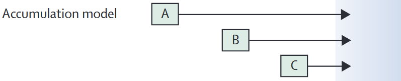
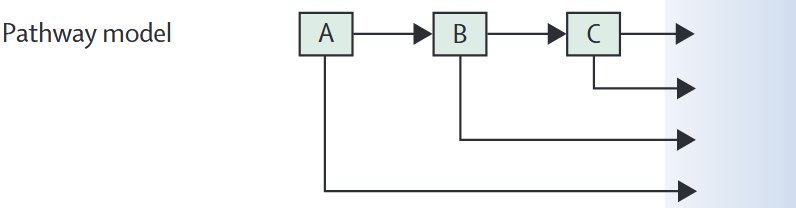
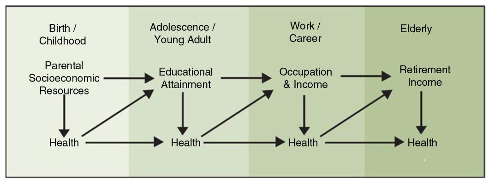
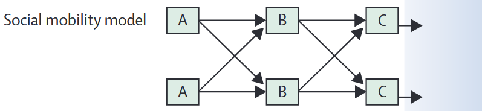
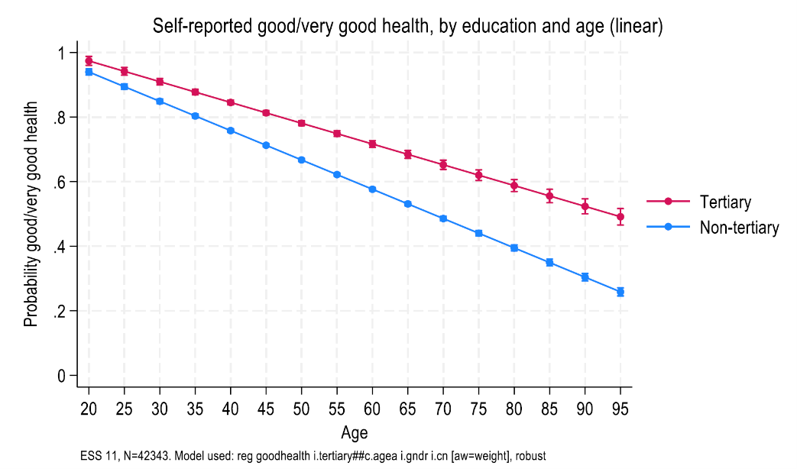
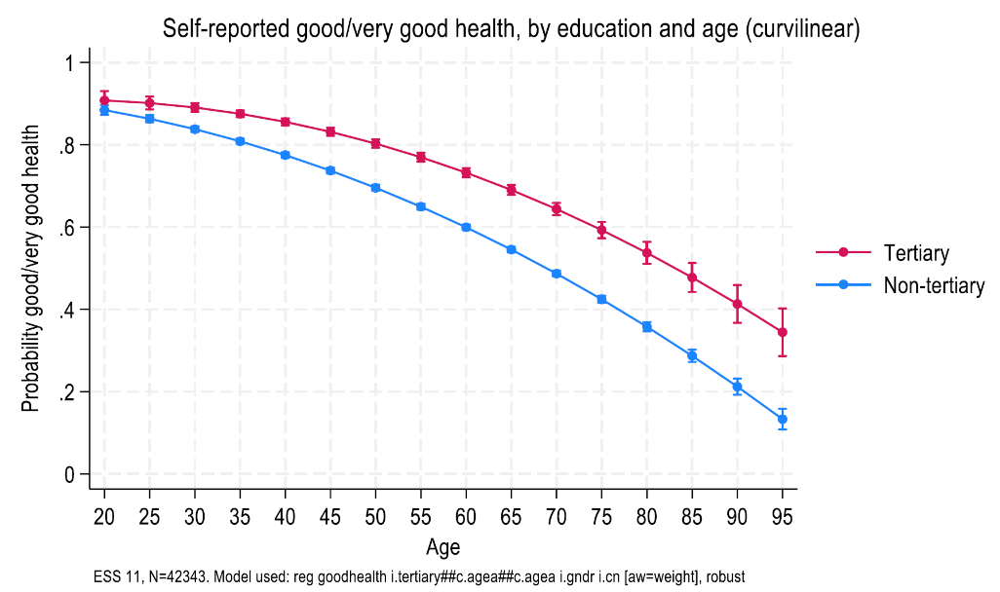
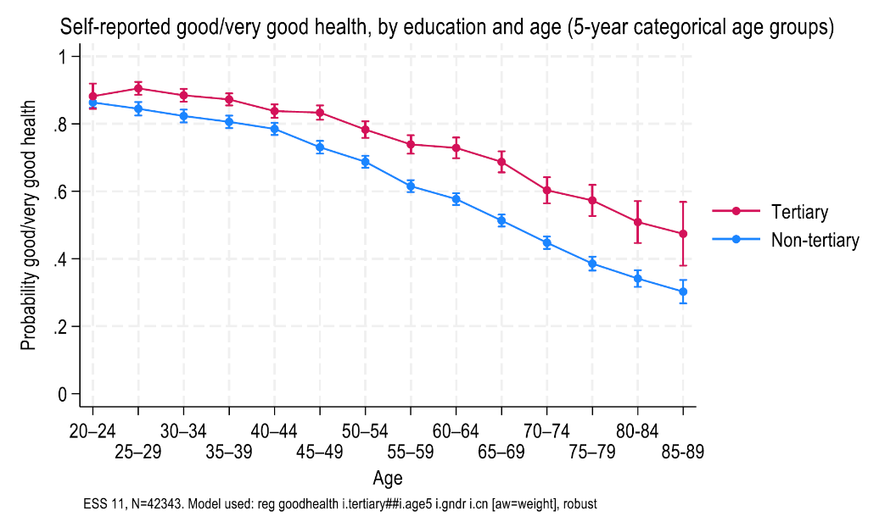
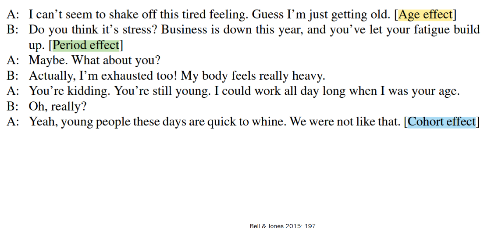

::: session-lead
Why are social inequalities in health often visible decades after their
origins? Does it matter **when** disadvantage occurs, **how long** it
lasts, or whether people's circumstances improve or deteriorate?
:::

Today we examine health inequality as a process unfolding **across the
life course**, rather than as a difference between groups at one moment
in time. We introduce the main principles and causal models, apply them
to evidence on chronic diseases, and discuss what they imply for public
policy. In the applied part, we use age-related patterns in ESS and ISSP
to examine both the potential and the limitations of cross-sectional
data.

**Today's route:** Life-course perspective → Five principles → Four
models → @wagnerLifeCourseEpidemiology2024: disease examples and
prevention → Embodiment → Age, period and cohort → Applied analysis.

**Learning objectives.** By the end of the session, you should be able
to explain the five life-course principles; distinguish
critical/sensitive period, accumulation, pathway and social mobility
models; connect them to concrete health inequalities and policy
interventions; and explain why age differences in cross-sectional
surveys are not necessarily changes within individuals over time.

::: {.callout-note collapse="true"}
### Mandatory reading

@wagnerLifeCourseEpidemiology2024 — [Read the
article](https://doi.org/10.1016/S2468-2667(24)00018-5).

As you read, focus particularly on **Figure 1** (four causal models),
**Figure 2** (hypertension, breast cancer and dementia), **Figure 4**
(the policy dimension), and the discussion of causal inference and
policy challenges on pp. e265–e266.
:::

::: {style="height: 1.5rem;"}
:::

## Organisational matters

### Visit to the LUPS Drop-in

We will visit the [**LUPS
Drop-in**](https://www.lups.ch/erwachsene/drop-in/) on two alternative
dates:

- **Thursday, 26 November, 10:00–11:45**
- **Thursday, 3 December, 10:00–11:45**

{fig-align="center" width="82"}

Please [**choose one of the two
dates**.](https://forms.cloud.microsoft/Pages/ResponsePage.aspx?id=3ZnXZFMqJkeCWJS92OT-Ne3CbyYHOH1Mj2DV8648CzRUNTA1VVFGSDNWR0hURTdGSEVWSlo3SzAwVS4u)
You only need to attend one visit.

### Student presentations: Empirical research papers

The presentations will take place on **3 and 10 December**, according to
your submitted preferences.

| **Thursday, 3 December**<br>12:30–14:00 | **Thursday, 10 December**<br>10:00–14:00 |
|------------------------------------|------------------------------------|
| Laura Schmid | Hannah Steinhäuser & Katia Gmür |
| Verena Izzo & Miheyon Kim | Moree van de Bree |
| Zehra Zukovic | Abigail Anim |
| Lea Zbinden | Janine Visser & Mailin Loitz |
| (...others?) | (...others?) |

**Presentation format:** 10 minutes per presentation, followed by 10
minutes for questions and discussion.

### Next week: field trip – visit to Tragwerk Luzern

Next week from **8:00-10:00 a.m.**, we have the chance to visit the
organisation Tragwerk Luzern (<https://www.tragwerk-luzern.ch/>), a
local support centre for people affected by addiction, poverty, and
social disadvantage.

Please let me know if you [cannot]{.underline} join.

Meeting point: 7:55 a.m. at Murbacherstrasse 20, 6002 Luzern ([Google
Maps](https://maps.app.goo.gl/4WXE9sSmAhSnSJ8T6))

::: {style="height: 1.5rem;"}
:::

## From social position to social trajectories

In previous sessions, we examined inequalities structured by
**socioeconomic position**, **gender**, **migration** and other social
classifications. Much of that evidence compared individuals or groups at
a particular point in time.

A life-course perspective adds a crucial dimension: **time**.

- What were someone's circumstances *earlier in life*?
- At what *age* did an exposure or transition occur?
- For how *long* was someone exposed to disadvantage?
- How did social and health circumstances *change*, and how did earlier
  conditions shape subsequent opportunities?
- How are lives shaped by *families, historical events and public
  institutions*?

This approach is not a single theory or method. It is an
**interdisciplinary framework** connecting sociology, demography,
psychology, biology and social epidemiology
[@bartleyHealthInequalityIntroduction2025, chap. 7;
@wagnerLifeCourseEpidemiology2024, p. e261].

::: {.callout-tip appearance="simple"}
## A simple example

Two people have the **same income at age 60**. One experienced poverty
throughout childhood and much of adulthood; the other experienced
financial security until a recent job loss. A cross-sectional measure of
current income treats them alike. A life-course approach asks whether
their **different histories** matter for health.
:::

::: {style="height: 1.8rem;"}
:::

## 1. Origins and five principles of the life-course approach

### Origins: between biography and history

The approach developed from research on human development, notably
**Glen Elder's** study of children whose lives were shaped by the Great
Depression. It connects **individual biographies** with **historical
circumstances** and highlights the value of longitudinal observation. In
health research, it subsequently converged with birth-cohort studies and
research on the developmental origins of adult disease
[@elderChildrenGreatDepression1974;
@bartleyHealthInequalityIntroduction2025, pp. 127–132].

{fig-align="center" width="40%"}

### Five principles

The principles below follow @elderLifeCourseHuman2007, as presented in
@wagnerLifeCourseEpidemiology2024 (p. e261).

| Principle | Central idea | Example for health inequality |
|------------------------|------------------------|------------------------|
| **1. Life-span development** | Human development and ageing are **lifelong processes**. | Health, cognitive functioning and social resources change from childhood to old age. |
| **2. Human agency** | People make choices and shape their lives **within opportunities and constraints**. | Choices about employment or health behaviour depend partly on financial resources, care responsibilities and institutional opportunities. |
| **3. Timing** | Consequences depend on **when** events or exposures occur. | Malnutrition during pregnancy may have different implications from malnutrition in midlife; unemployment during school-to-work transitions may differ from unemployment shortly before retirement. |
| **4. Linked lives** | Lives are **interdependent** and embedded in relationships. | Parental job loss may affect children's living conditions; illness or care needs can change partners' employment trajectories. |
| **5. Historical time and place** | Life courses are shaped by **cohorts, institutions, places and historical events**. | Growing up during an economic crisis or before an expansion of social protection can shape later opportunities. |

*Sources: @elderLifeCourseHuman2007; @wagnerLifeCourseEpidemiology2024,
p. e261; @bartleyHealthInequalityIntroduction2025, pp. 131–132.*

::: menti-prompt
**DISCUSSION \| Timing, linked lives and social structures**

If two people experience a serious household income loss, why might the
health consequences differ depending on whether it occurs during
childhood, early adulthood or retirement? Which of Elder's five
principles help you explain the differences?
:::

::: {style="height: 2rem;"}
:::

## 2. Four models of how inequalities develop over time

The five principles help us formulate more specific hypotheses about
**how exposures produce later health outcomes**.
@wagnerLifeCourseEpidemiology2024 distinguish four influential causal
models. These models are simplifications: real life courses often
combine several mechanisms.

{fig-align="center" width="523"}

::: {style="height: 1.8rem;"}
:::

### 2.1 Critical and sensitive periods: *When* does exposure occur?

{fig-align="center" width="500"}

**Critical period:** An exposure can have a lasting effect because it
occurs during a particular developmental window. In the strongest
formulation, later experiences cannot fully compensate for the impact.

**Sensitive period:** The influence of an exposure is **stronger during
some periods than others**, but effects may be less permanent and
recovery remains possible.

@bartleyHealthInequalityIntroduction2025 (p. 133) distinguish these
concepts; @wagnerLifeCourseEpidemiology2024 (p. e262) illustrate them
with the timing of prenatal famine and early-childhood lead exposure.

::: {.callout-note appearance="simple"}
## Example: The Dutch Hunger Winter, 1944–45

Research on people exposed to famine **before birth** links the timing
of prenatal nutritional deprivation to different health outcomes later
in life, including coronary heart disease, obstructive airways disease
and glucose tolerance. The relevant question is not just *whether* their
mothers experienced famine, but **during which stage of pregnancy**. See
@painterPrenatalExposureDutch2005 and @wagnerLifeCourseEpidemiology2024
(p. e262).

**Interpretation:** This is evidence consistent with timing-dependent
effects; it does not imply that all disadvantages in childhood are
irreversible.
:::

::: {style="height: 1.6rem;"}
:::

### 2.2 Accumulation: *How much* disadvantage builds up?

{fig-align="center" width="500"}

The **accumulation model** focuses on the **duration and accumulation**
of exposures. Health risk may increase because the same adverse
condition persists, or because several different risk factors combine
over time [@wagnerLifeCourseEpidemiology2024, p. e262].

- **Repeated disadvantage:** Several periods of poverty or insecure
  employment.
- **Multiple exposures:** Poor housing, stressful work and environmental
  pollution, sometimes overlapping.
- **Cumulative advantage:** Stable economic security and access to
  protective resources across several life stages.

**Empirical example:** @singh-manouxSocioeconomicTrajectoriesLife2004
followed socioeconomic positions across the life course and found
patterns consistent with an accumulation of disadvantage in midlife
health outcomes.

::: {.callout-important appearance="simple"}
## What would distinguish accumulation from a critical period?

If exposure in **early childhood** matters more than comparable exposure
later, this supports a **timing** argument. If the **number or
duration** of disadvantaged periods matters most, this supports an
**accumulation** argument. A given study may find evidence of both.
:::

::: {style="height: 1.6rem;"}
:::

### 2.3 Pathways or chains of risk: *How does one exposure lead to another?*

{fig-align="center" width="500"}

The **pathway model** describes a **sequence of linked exposures**: one
disadvantage increases the probability of another, setting in motion a
chain of risk [@wagnerLifeCourseEpidemiology2024, p. e262].



*Illustrative pathway based on
[@arcayaInequalitiesHealthDefinitions2015]. The arrows represent a
proposed causal sequence rather than effects identified by this
diagram.*

A related empirical example is childhood socioeconomic position,
subsequent health behaviours and adult health
[@vandemheenDoesChildhoodSocioeconomic1998].

**Connection to last session:** This resembles **mediation**, but
life-course research often requires measurements of several mediators at
different times and attention to time-varying confounding.

::: {style="height: 1.6rem;"}
:::

### 2.4 Social mobility: *Does the direction of change matter?*

{fig-align="center" width="500"}

**Social mobility** refers to movements between socioeconomic positions,
either **between generations** (parents and children) or **within an
individual's life**. Relevant questions include whether health depends
mainly on the **origin**, the **destination**, or the **experience and
direction of mobility** itself.

| Childhood position | Adult position  | Trajectory          |
|--------------------|-----------------|---------------------|
| More advantaged    | More advantaged | Stable advantage    |
| Less advantaged    | Less advantaged | Stable disadvantage |
| Less advantaged    | More advantaged | Upward mobility     |
| More advantaged    | Less advantaged | Downward mobility   |

@wagnerLifeCourseEpidemiology2024 (p. e262) discuss a Swedish study in
which moving from non-manual to manual occupations was associated with a
greater risk of myocardial infarction than remaining in the same
occupational class. However, it is difficult to separate the effect of
**mobility itself** from the influence of the **starting and ending
positions**.

<details>

<summary><strong>Compare the models: Do they make different
predictions?</strong></summary>

Consider two people who spent one of three observed life stages in
poverty. Person A experienced poverty only in childhood; Person B
experienced poverty only in adulthood.

- A **simple accumulation model** might predict similar risks, given
  equal duration of exposure.
- A **sensitive-period model** could predict a larger impact of
  childhood poverty.
- A **pathway model** would ask whether early poverty also caused
  further disadvantage that lasted into adulthood.
- A **mobility model** would ask whether moving into or out of poverty
  matters beyond the positions themselves.

These hypotheses require appropriately timed longitudinal data to be
distinguished credibly.

</details>

::: {style="height: 2rem;"}
:::

## 3. Applying the models: Three chronic diseases

The mandatory reading uses **hypertension, breast cancer and dementia**
to show why exposures should be investigated across several life
stages—not only at the age when a condition is diagnosed.

{#fig-three-conditions
fig-align="center" width="95%"}

::: {style="height: 1.6rem;"}
:::

### Hypertension

Hypertension has risk factors extending from **before birth** to later
life. @wagnerLifeCourseEpidemiology2024 (pp. e263–e264) describe the
roles of maternal blood pressure and prenatal exposures, childhood diet
and physical activity, and adult obesity, alcohol intake and salt
consumption.

**Policy implications:** Creating healthier environments in childhood,
reducing population salt consumption and improving physical activity can
complement **screening and treatment** in midlife and older age.

### Breast cancer

Breast cancer demonstrates why **biological timing** may matter. The
relationship between adiposity and disease risk differs across
reproductive stages; factors such as age at menarche, first birth,
pregnancy and menopause help define distinct exposure windows.

**Policy implications:** Screening detects disease at relevant ages, but
a life-course strategy also asks about environmental and behavioural
exposures much earlier in life [@wagnerLifeCourseEpidemiology2024, p.
e264].

### Dementia

Risk of dementia in later life is related to factors distributed across
the life course: **education** earlier in life, **vascular risk and
hearing loss** in midlife, and **social isolation and other health
conditions** in later life. The reading emphasises *cognitive reserve*
and the possibility of prevention at several ages.

**Policy implications:** Education policy and opportunities for
cognitive activity can complement midlife cardiovascular prevention and
support against isolation in later life
[@wagnerLifeCourseEpidemiology2024, pp. e264–e265].

::: menti-prompt
**GROUP DISCUSSION \| Applying the mandatory reading**

Form three groups: **hypertension**, **breast cancer** and **dementia**.
Using @wagnerLifeCourseEpidemiology2024 (pp. e263–e265), prepare a short
response:

1.  Which exposures matter at which stages of the life course?
2.  Which of the **four life-course models** best describe the proposed
    mechanisms? Could more than one apply?
3.  Which intervention would you prioritise, **at what age**, and **at
    which policy level** (individual, family, community or state)?

Allow approximately **10 minutes** for discussion and **3 minutes per
group** for reporting back.
:::

::: {style="height: 2rem;"}
:::

## 4. Embodiment: How do social conditions become biological inequalities?

@bartleyHealthInequalityIntroduction2025 (chap. 7, pp. 139–146) connect
the life-course framework to **embodiment**: the process through which
people's social and physical environments become reflected in their
biological functioning and health.

This connects directly to our previous sessions on **material,
behavioural and psychosocial explanations**. The same pathways can
operate repeatedly across the life course.

| Mechanism | How it works | Example |
|------------------------|------------------------|------------------------|
| **Exogenous exposures** | Social circumstances shape contact with external agents that affect the body. | Air pollution, infections or occupational hazards; exposure depends on housing, work and neighbourhood. |
| **Endogenous responses** | Social conditions activate internal physiological responses over time. | Chronic stress and repeated discrimination can contribute to physiological wear and tear (*allostatic load*). |

In particular, **weathering** describes accelerated biological ageing
associated with repeated exposure to disadvantage and discrimination.
These concepts help explain how differences in material and social
conditions can accumulate into inequalities in biological health
[@bartleyHealthInequalityIntroduction2025, pp. 143–146].

::: {.callout-note appearance="simple"}
## A connection across our course

The life-course perspective does **not** replace behavioural, material
or psychosocial explanations. Rather, it asks **when these processes
operate, for how long, in which sequence and with which long-term
consequences**.
:::

::: {style="height: 2rem;"}
:::

## 5. From life-course evidence to public policy

@wagnerLifeCourseEpidemiology2024 argue that life-course epidemiology
offers opportunities for **primordial prevention**: preventing exposure
to risk factors in the first place, not merely detecting or treating
disease once it occurs.

{#fig-intervention-trajectories
fig-align="center" width="92%"}

### Intervene earlier, later—or throughout life?

The optimal choice depends on the health outcome, **the mechanism** and
the **policy objective**.

- **Early-life intervention:** Reduce childhood poverty, improve
  nutrition, housing and educational opportunities.
- **Population-wide prevention:** Change environments and regulation
  (e.g. food standards or walkable urban spaces) across all ages.
- **Later-life intervention:** Provide screening, treatment,
  rehabilitation and support for people already at elevated risk.
- **Vulnerable populations:** Reduce systematically unequal exposure and
  barriers to protective resources.

The *eco-social* framework in @wagnerLifeCourseEpidemiology2024
emphasises that prevention can act at the level of individuals,
families, communities, cities and countries—not only through individual
behaviour change.

{#fig-policy-matrix
fig-align="center" width="94%"}

::: {.callout-warning appearance="simple"}
## Two challenges for policy

**Delayed benefits:** Investments in early-life conditions may yield
large benefits only decades later, while political and fiscal incentives
often favour shorter time horizons.

**Precision versus simplicity:** Identifying a sensitive window can help
target interventions, but overly narrow targeting may miss the benefits
of reducing common risks **throughout the population**.

@wagnerLifeCourseEpidemiology2024 (p. e266) also note that even small
effects at the individual level can matter greatly when an exposure is
widespread.
:::

::: {style="height: 1.8rem;"}
:::

### Swiss practice: Life-course prevention and health promotion

How explicitly is the life-course perspective reflected in Swiss health
policy? Switzerland provides an interesting example because national
strategies establish priorities, while cantons and municipalities play
an important role in implementation.

#### Federal level: Health2030 and the NCD Strategy

The Federal Council's [Health2030
strategy](https://www.bag.admin.ch/de/so-wird-gesundheit2030-umgesetzt)
sets out eight objectives for Swiss health policy. One is **"Healthy
ageing" (Gesund älter werden)**, which includes two priorities:

- Strengthening the prevention of non-communicable diseases (NCDs).
- Improving the health of children and adolescents.

{fig-align="center" width="376"}

The objective is therefore not restricted to old age. It recognises that
the conditions for healthy ageing are established **throughout the life
course**.

The more specific [National NCD
Strategy](https://www.bag.admin.ch/de/ncd-strategie-auftrag-ziele-massnahmen-und-steuerung)
was developed jointly by the FOPH, the cantons and Health Promotion
Switzerland. Originally covering 2017–2024, it has been extended until
**2028**.

Its objectives include preventing or delaying chronic diseases, reducing
premature mortality, strengthening health-promoting environments and
improving **health equity**.

The **2025–2028 action plan** is particularly relevant to the
life-course approach:

- **Life stages and settings:** Prevention should reflect the conditions
  and needs of people at different ages and in different social
  environments.
- **Accumulation of risk:** Long-term exposure to smoking, unhealthy
  nutrition, physical inactivity and socioeconomic disadvantage can
  contribute to chronic disease.
- **Health equity:** Preventive measures should reach groups facing
  socioeconomic disadvantage and other structural barriers.
- **Prevention across the care continuum:** Health promotion should
  complement prevention, treatment and care.

The current implementation priorities include mental health, tobacco and
nicotine prevention, and overweight and obesity prevention. Dementia
prevention has also gained prominence.

**A concrete example:** The FOPH's [Early childhood influences lifelong
health](https://www.bag.admin.ch/de/fruehe-kindheit-beeinflusst-gesundheit-ein-leben-lang)
initiative emphasises pregnancy and the first years of life. It focuses
particularly on families experiencing socioeconomic disadvantage and
promotes coordinated support across healthcare, education and social
services.

::: {.callout-note appearance="simple"}
## How does this relate to life-course theory?

**Sensitive periods:** Supporting families during pregnancy and early
childhood, when some exposures have particularly important developmental
consequences.

**Accumulation:** Reducing repeated exposure to health risks and
disadvantage across different life stages.

**Pathways:** Preventing early disadvantages from contributing to later
inequalities in education, employment and health.

The NCD Strategy provides a policy framework that is consistent with
these models, but it does not necessarily distinguish or empirically
test the different causal mechanisms.
:::

::: {style="height: 1.5rem;"}
:::

#### Cantonal level: How does Lucerne implement these priorities?

The Canton of Lucerne has its own [Health Promotion Strategy 2021–2033
("Gesundes
Luzern")](https://gesundheit.lu.ch/themen/gesundheitsfoerderung/Gesundes_Luzern).
Its overarching objective is to create environments that support healthy
living.

The strategy is implemented through successive thematic priorities:
**physical activity-friendly environments (2021–2024)** and **social
encounters and connections (from 2025)**.

In addition, the cantonal [Health Promotion Programme
2026–2029](https://gesundheit.lu.ch/themen/gesundheitsfoerderung/Projektunterstuetzung)
supports non-profit projects promoting nutrition, physical activity and
mental health among children, young people and older adults.

The following examples illustrate how these policies address different
life stages:

| Life stage | Policies and measures in Lucerne | Life-course perspective |
|------------------------|------------------------|------------------------|
| **Early childhood** | [Frühe Förderung](https://disg.lu.ch/themen/kjf/fruehe_foerderung): parental counselling, early language development, support for families and coordination between local services. The canton offers start-up funding to municipalities developing early-childhood provision. | Early childhood as a **sensitive period**; improving starting conditions and preventing chains of disadvantage. |
| **Childhood and adolescence** | [Psychische Gesundheit](https://gesundheit.lu.ch/themen/gesundheitsfoerderung/psyche/Programm): mental health promotion in schools, strengthening resilience and supporting transitions into adulthood. These were explicit objectives of the 2022–2025 programme. | **Timing**, life transitions and **linked lives**; supporting young people within families, schools and communities. |
| **Older age** | [Gesundheit im Alter](https://gesundheit.lu.ch/themen/gesundheitsfoerderung/Gesundheit_im_Alter/Programm): promoting physical activity, nutrition and mental health, including fall prevention, social participation and support for vulnerable older people. | Preventing further **accumulation of risk**, maintaining functioning and supporting healthy ageing. |
| **Across life stages** | [Gesundes Luzern](https://gesundheit.lu.ch/themen/gesundheitsfoerderung/Gesundes_Luzern): creating environments that encourage movement, social encounters and supportive relationships. | Addressing **social and environmental determinants** of health across the life course, rather than focusing only on individual behaviour. |

The 2026–2029 programme provides a current funding framework; some
linked programme descriptions refer to the preceding 2022–2025 period.

Importantly, the cantonal approach combines **individual-level
prevention** (such as strengthening health literacy) with
**environmental and community interventions** (such as improving
opportunities for physical activity and social participation).

:::::::::: menti-prompt
::: {.callout-tip appearance="simple"}
#### Discussion: From life-course theory to policy evaluation

1.  Which of the **four life-course models** provides the strongest
    rationale for each programme?
2.  Do these measures mainly change **individual behaviour**, or also
    the **conditions** that shape exposure to disadvantage?
3.  What data and follow-up period would be needed to establish whether
    a programme reduces **health inequalities**, rather than only
    improving average health?

**Important:** The programmes illustrate life-course reasoning in public
policy. Their existence does not establish that they have already
reduced health inequalities.
:::

::: {style="height: 2rem;"}
:::

## 6. Applied focus: Age-related health inequalities in ESS and ISSP

The ESS and ISSP are valuable for studying **age differences** in
health, but cross-sectional surveys do not automatically reveal
**within-person health trajectories**. We need to distinguish the
measurement of age from the life-course processes we want to explain.

### Age as a proxy for life stages

The following graphs show the predicted probability of reporting **good
or very good health** across ages, separately for people with and
without tertiary education in ESS Round 11. The general pattern shows
lower reported good health at higher ages, and an educational gap across
much of the age distribution.

**Approach 1 –** **Linear age:** Assumes the association changes at a
constant rate.



**Approach 2 – Curvilinear age:** Allows the age–health association to
bend.



**Approach 3 – Age groups:** Estimates separate categories (e.g.
five-year age bands), making fewer assumptions about the functional
form.



**Discussion:** Would you interpret the difference between people aged
30 and 70 in the same survey as the health change that an individual
experiences over 40 years? Why not?

::: {style="height: 1.5rem;"}
:::

### Age, period and cohort: Three different explanations

| Dimension | Question | Illustration |
|------------------------|------------------------|------------------------|
| **Age effect** | What changes as people grow older? | Physiological ageing and age-related functional limitations. |
| **Period effect** | What changes for people of many ages at a particular time? | A pandemic, recession or major healthcare reform. |
| **Cohort effect** | What differs between generations born in different periods? | Educational opportunities, childhood nutrition or exposure to war and welfare-state expansion. |

::: {.callout-important appearance="simple"}
## The age–period–cohort identification problem

**Age = calendar period − birth cohort.** These three variables are
perfectly linearly dependent. Their independent linear effects cannot
all be identified without additional assumptions or restrictions.



There is no universally assumption-free statistical solution. Model
choices should follow the question, and robustness checks should make
assumptions transparent [@bellAgePeriodCohort2015].
:::

## 7. Takeaways and outlook next week

1.  **Health inequalities have histories.** Earlier social conditions
    can matter long after the original exposure, while later
    circumstances can reinforce or partly offset them.
2.  **Timing, duration, sequence and mobility are different
    mechanisms.** Critical/sensitive periods, accumulation, pathways and
    social mobility generate distinct—but potentially
    overlapping—hypotheses.
3.  **Social inequality becomes embodied over time.** Material,
    behavioural and psychosocial pathways interact with biological
    processes across life stages.
4.  **Public policy can act at several ages and levels.** Life-course
    evidence can inform early prevention, population-wide protection and
    later treatment; it does not imply that intervention in adulthood is
    too late.
5.  **Age differences are not trajectories.** Repeated cross-sectional
    ESS/ISSP data cannot independently identify ageing, period and
    cohort processes without assumptions.

**Final question:** If preventing disadvantage in childhood produces
health benefits decades later, what makes such policies politically
challenging—and how might policy makers nevertheless justify them?

### Next week: Health inequalities across places and neighbourhoods

### Field trip – visit to Tragwerk Luzern

Next week from **8:00-10:00 a.m.**, we have the chance to visit the
organisation Tragwerk Luzern (<https://www.tragwerk-luzern.ch/>), a
local support centre for people affected by addiction, poverty, and
social disadvantage.

Please let me know if you [cannot]{.underline} join.

Meeting point: 7:55 a.m. at Murbacherstrasse **20, 6002 Luzern ([Google
Maps](https://maps.app.goo.gl/4WXE9sSmAhSnSJ8T6))**

**10:15-13:45: normal in-class session as usual.**

Reading: Hasager, L., & Jørgensen, M. (2026). Sick of your poor
neighborhood? Quasi-experimental evidence on neighborhood effects on
health. Journal of Public Economics, 256, 105599.
<https://doi.org/10.1016/j.jpubeco.2026.105599>.

::: {style="height: 1.5rem;"}
:::

::: {style="height: 1.5rem;"}
:::

## References

::: {#refs}
:::

```{=html}
<style>
/* Preserve the main course website's typography and colour palette. */
.menti-prompt {
  border-top: 1px solid #dedede;
  border-bottom: 1px solid #dedede;
  margin: 2.8rem 0;
  padding: 1.35rem 0;
}
.menti-prompt > p:first-child {
  font-size: .79rem;
  font-weight: 700;
  color: #b51f2e;
  letter-spacing: .035em;
}
.menti-prompt details { margin-top: 1rem; }
main.content > section { margin-bottom: 2rem; }
main.content img { max-width: 100%; }
</style>
```
::::::::::
