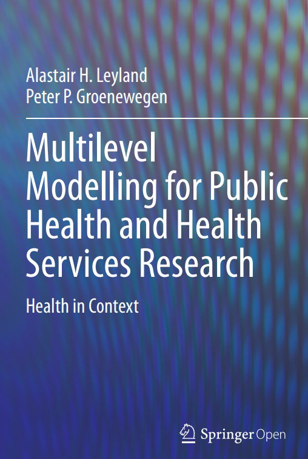

::: session-lead
**Where we live matters for health.** But why do people in poorer areas
have worse health? Is it because different people live there, because
the places themselves are different, or because wider political and
economic structures shape both people and places?
:::

Today we examine geographical inequalities at **regional, municipal,
neighbourhood and hyperlocal levels**. We retain the central distinction
between **composition and context**, then extend it to relational and
political-economy perspectives. The mandatory reading uses a Danish
refugee allocation policy to test whether neighbourhood disadvantage
*causes* poorer health. The applied part focuses on **multilevel
regression**, control variables and implications for your empirical
paper.

**Today's route:** Field visit to Tragwerk Luzern → From national to
hyperlocal areas → Composition and context → Relational and political
economy perspectives → The mandatory reading → Multilevel modelling →
Good and bad controls.

**Learning objectives:** By the end of the session, you should be able
to recognise spatial health inequalities at different geographical
scales; distinguish compositional from contextual explanations;
interpret the identification strategy and findings of
@hasagerSickYourPoor2026; understand random-intercept and random-slope
multilevel models; and consider which covariates belong in an empirical
model.

::: {.callout-note collapse="true"}
### Mandatory reading

@hasagerSickYourPoor2026 — [Read the
article](https://doi.org/10.1016/j.jpubeco.2026.105599).

Focus on the **research design** (the Danish Spatial Dispersal Policy),
**Table 4** (main results), **Table 11** (apartment-building versus
larger area effects), and the discussion of mechanisms. How do the
authors address residential selection?
:::

::: {style="height: 1.5rem;"}
:::

## Organisational: Field trip to Tragwerk Luzern

**Thursday, 19 November 2026, 08:00–10:00** — field visit to **Tragwerk
Luzern**, a local support centre for people affected by addiction,
poverty and social disadvantage.

During the visit, consider how **individual circumstances** and **local
social and institutional environments** interact. What can a local
support service do, and which determinants of disadvantage lie beyond
its immediate reach?

::: {.callout-tip appearance="simple"}
### A question to take from the field visit

Which aspects of the work at Tragwerk could be understood as addressing
**compositional** factors (characteristics and resources of people), and
which as addressing **contextual** factors (local institutions and
opportunities)? Are these two categories easy to separate?
:::

::: {style="height: 1.8rem;"}
:::

## 1. Health inequalities at different geographical levels

### Warm-up: Why does health vary across places?

::: menti-prompt
**WARM-UP EXERCISE**

Why is there health inequality across …

- **regions** (for example, Swiss cantons)?
- **municipalities**?
- **neighbourhoods**?

For each level, think of **one possible explanation**.
:::

### From national to (hyper)local areas

A countrywide average can hide considerable differences at smaller
scales. The same question—*where do people live, and how healthy are
they?*—can be asked at increasingly fine levels of geography.

#### Regional level: Swiss cantons and European regions

{fig-align="center"
width="92%"}

[Explore the original FSO indicator
map](https://mapexplorer.bfs.admin.ch/?lang=de#c=indicator&f=f&i=ch_01_04_05b.lebenserwartung&s=2023_slash_24&view=map164).

The map shows geographical differences **within Switzerland**. What
might explain them? Differences in the distribution of residents, in
cantonal institutions, or both?

{fig-align="center"
width="92%"}

For cross-regional comparisons, **NUTS** (Nomenclature of Territorial
Units for Statistics) provides a standard classification of European
regions. The choice of geographical unit influences what we observe.

- [Eurostat: deaths by age, sex and NUTS 3
  region](https://ec.europa.eu/eurostat/databrowser/view/demo_r_magec3/default/table?lang=en)
- [Eurostat Statistical Atlas / Regional
  Yearbooks](https://ec.europa.eu/statistical-atlas/)

{fig-align="center"
width="92%"}

#### Municipal level: Life expectancy in Germany

{fig-align="center"
width="95%"}

**Question:** Are municipal boundaries meaningful units for health
research? Which inequalities might disappear when we aggregate areas?

#### Neighbourhood level: Chicago and Geneva

{fig-align="center" width="72%"}

[Read the accompanying article in *The
Economist*](https://www.economist.com/united-states/2019/10/10/a-ride-along-chicagos-red-line).

{fig-align="center"
width="86%"}

{fig-align="center"
width="90%"}

These examples show how geographical variation can be visible **within a
single city**, not only between countries or cantons. A map documents
spatial differences; it does **not yet establish** what causes them.

::: {style="height: 1.8rem;"}
:::

## 2. Measuring neighbourhood socioeconomic position in Switzerland

### The Swiss neighbourhood index of socioeconomic position (Swiss-SEP)

The original **Swiss-SEP** was developed by
@panczakSwissNeighbourhoodIndex2012 using the **2000 Census** and
geocoded residential addresses. A neighbourhood was defined using the
**50 nearest households along the road network**, rather than an
administrative district.

The index combines four indicators:

- **Income**, proxied by median rent;
- **Education**;
- **Occupation**;
- **Crowding**.

{fig-align="center"
width="86%"}

{fig-align="center"
width="91%"}

### Neighbourhood SEP and health outcomes

{fig-align="center" width="95%"}

{fig-align="center"
width="95%"}

Notice how much the **estimated social gradient** can change when
neighbourhood SEP is measured at a finer geographical scale. This is a
practical consequence of the [*modifiable areal unit problem* (MAUP)](https://www.sciencedirect.com/topics/earth-and-planetary-sciences/modifiable-areal-unit-problem):
results can depend on how we delineate and aggregate places.

During the first two COVID-19 waves in Switzerland, less affluent
neighbourhoods also experienced substantial differences along the **care
cascade**, from testing to hospitalisation and mortality
[@riouSocioeconomicPositionCOVID192021].

{fig-align="center"
width="94%"}

### Updated Swiss-SEP 2

Swiss-SEP 2 updates and revalidates the index using **2012–2015
microcensus data** [@panczakSwissNeighbourhoodIndex2023].

{fig-align="center"
width="93%"}

Explore a **Swiss-SEP 2-based interactive map** from *Tages-Anzeiger*,
with examples from Zürich and Lucerne.

{fig-align="center"
width="94%"}

[Explore the Swiss-SEP 2 interactive
map](https://www.tagesanzeiger.ch/armut-und-reichtum-in-der-schweiz-diese-karte-zeigt-wo-die-privilegierten-wohnen-898746224551).

::: menti-prompt
**MAP DISCUSSION**

Look at the map for **Lucerne**. How much socioeconomic variation might
be hidden when we only compare municipalities or cantons? What can and
cannot be inferred from the map about residents' health?
:::

::: {style="height: 2rem;"}
:::

## 3. Why does health vary across places? Composition versus context

Two explanations help organise the evidence:

| Explanation | Main idea | Examples |
|------------------------|------------------------|------------------------|
| **Compositional** | Health differences reflect the **characteristics of individuals** living in different places. | Age structure, education, income, occupational risks, health behaviours. |
| **Contextual** | Health differences reflect features of the **local environment** affecting residents. | Housing, pollution, green space, local labour markets, social networks, services and institutions. |

**Individual characteristics** (demographic, behavioural and
socioeconomic) and **local environments** (economic, social, physical
and institutional) can both shape **geographical health inequalities**.

::: menti-prompt
**EXERCISE \| Composition or context?**

Pick one level—**region, municipality or neighbourhood**. Think of one
**compositional** and one **contextual** explanation for differences in
health at that level.
:::


### Example: Does moving to Jackson Hole make you live longer?

Teton County, Wyoming (home of Jackson Hole), recently reported a
remarkable **life expectancy of 94 years**. But does living there
actually make people healthier?

Demographer [Jennifer Beam Dowd](https://jenndowd.substack.com/p/sorry-moving-to-jackson-hole-wont) [@dowdSorryMovingJackson2026]
raises two important concerns:

- **Residential selection (composition):** Wealthy, healthy and
  physically active people may be more likely to move to Jackson
  Hole, while older residents with declining health may move away.
- **Measurement:** In a small population, life expectancy estimates
  are sensitive to the numbers of deaths and residents at each age.
  The CDC-based estimate is **88.9 years**, considerably below
  the locally reported figure of 94.

This illustrates why **high life expectancy in a place does not
necessarily imply a causal health benefit of living there**. Both
selective migration and the measurement of mortality rates matter.

::: {.menti-prompt}
**DISCUSSION**

If you moved to Jackson Hole tomorrow, would you expect to live
longer? What evidence would we need to distinguish a genuine
**place effect** from **residential selection**?
:::


### The relational perspective

Composition and context should not be regarded simply as two competing
explanations. People interact with environments, and environments are
also shaped by the people living in them.

The **relational perspective** emphasises a *mutually reinforcing and
reciprocal relationship between people and place*
[@cumminsUnderstandingRepresentingPlace2007].

#### Testing composition and context

The following figure from @leylandContextCompositionHow2020 illustrates
predicted health according to **individual** and **area** social
capital.

{fig-align="center"
width="95%"}

**How do we interpret** the association of self-rated health with
individual social capital and with neighbourhood (area) social capital?

#### Testing the relational perspective: Interactions

{fig-align="center"
width="95%"}

If the lines are **not parallel**, the association of one variable with
health depends on the value of the other. In statistical terms, we can
test a **cross-level interaction**.

::: {.callout-tip appearance="simple"}
### Link to the applied part

A multilevel model can include both **individual-level predictors** and
**area-level predictors**, as well as interactions between them. But
including predictors from both levels does **not** by itself establish
that an area-level association is causal.
:::

::: {style="height: 1.8rem;"}
:::

## 4. Do poorer neighbourhoods cause worse health?

@hasagerSickYourPoor2026 poses precisely the causal question raised by
the composition–context distinction: is the poor health of people in
poorer places a **neighbourhood effect**, or the result of **residential
selection**?

### Research design: A quasi-experiment in Denmark

- **Policy setting:** Denmark's Spatial Dispersal Policy allocated
  refugees to housing across municipalities and neighbourhoods during
  **1986–1998**.
- **Population:** **21,965** refugees aged 18–64 at arrival, identified
  from administrative registers.
- **Treatment:** Initial assignment to neighbourhoods in the bottom,
  middle or top third of **median neighbourhood income**.
- **Outcomes:** Subsequent hospital diagnoses of lifestyle-related
  diseases, particularly during **8–15 years after arrival**.
- **Identification:** The allocation procedure created **quasi-random
  variation conditional on the information available to housing
  officers**. The authors test whether initial characteristics not known
  to housing officers predict the neighbourhood of placement.

They compare refugees assigned within the **same municipality**, with
controls for individual characteristics at arrival, arrival-year and
municipality fixed effects, and municipal characteristics.

::: {.callout-important appearance="simple"}
### Why is this better evidence than a cross-sectional comparison?

If people with poorer health or fewer resources disproportionately move
to low-income neighbourhoods, a simple association between neighbourhood
income and health is **not a causal neighbourhood impact**. The
dispersal policy reduces this problem because refugees had limited
influence over their initial placement.

The causal interpretation still rests on the **conditional allocation
assumption** and on the way the study defines initial neighbourhood
exposure—not on randomisation in the strict experimental sense.
:::

### Main results

::: {.callout-note appearance="simple"}
### Main finding: approximately 12% higher risk

Refugees initially assigned to the **lowest-income third** of
neighbourhoods had an approximately **12% higher relative risk** of a
lifestyle-related disease diagnosis **8–15 years after arrival** than
refugees assigned to middle- or high-income neighbourhoods.

In **absolute terms**, the difference was about **1.8–1.9 percentage
points** (Table 4, Panel b). The authors find no statistically
significant average effect on hospital-diagnosed mental disorders.
:::

### What is meant by a neighbourhood? Scale matters again

The paper moves from **municipalities** to **parishes** (roughly 5,000
residents on average) and even to **apartment buildings** (roughly 15
residents on average in the sample). The very local environment is
especially predictive of later health outcomes (Table 11).

The authors find little evidence that differences in **municipal
healthcare access** or **individual earnings and employment** are the
main mechanisms. They suggest that **immediate neighbours and local
amenities** (potentially including social interaction, food and physical
activity opportunities) may matter. These mechanisms are **not directly
established**, however.

::: menti-prompt
**DISCUSSION \| Neighbourhood effects and causal identification**

1.  How does the refugee allocation policy help distinguish
    **composition** from **context**?
2.  Why might the **apartment building** matter more than the larger
    municipality? Which possible mechanisms can the authors actually
    test?
3.  What is the **estimand**: the effect of *initial assignment*, of
    neighbourhood income alone, or of a bundle of correlated local
    conditions?
4.  Would the same findings necessarily apply to the general Swiss
    population? Why or why not?
:::

::: {style="height: 2rem;"}
:::

## 5. Politics, institutions and the life course of place

### The political economy perspective

A narrow focus on composition versus context can obscure a more
structural question: **Why do different people live in different places
in the first place?**

- **Residential sorting and segregation** are shaped by housing markets,
  discrimination, employment and public policy.
- @slaterYourLifeChances2013 argues that a focus on *where you live
  affects your life chances* risks neglecting the reverse relationship:
  **life chances affect where people can live**.
- @bambraScalingPoliticsHealth2019 call for **scaling up** to the wider
  political and economic structures that shape both places and health.

### Example: Welfare-state institutions

Welfare-state institutions can influence the **distribution of people
across places**, the **resources available to them**, and the
**contextual conditions of different places**.
@beckfieldInstitutionalTheoryWelfare2015 distinguish four mechanisms:

1.  **Redistribution**;
2.  **Compression**;
3.  **Mediation**;
4.  **Imbrication** (overlap between institutions).

For example, redistributive policies can change household resources,
whereas social housing or regional public-service provision may alter
the environments in which people live. Political institutions are thus
not external to the composition/context distinction; they help produce
both sides of it.

### The life course of place

@pearceLifeCoursePlace2018 extend the **life-course perspective** from
Session 9 to geographical exposures:

- **Places change over time**;
- **People move between places at different ages**;
- **Exposure during some life stages** may have lasting consequences.

Using the **Lothian Birth Cohort 1936**, the authors relate childhood
neighbourhood disadvantage to mental health in later life and examine
the role of green space, particularly in disadvantaged areas.

{fig-align="center"
width="85%"}

::: {style="height: 2rem;"}
:::

## 6. Applied focus: Multilevel regression

{fig-align="center" width="178"}

### Why multilevel modelling?

Health data often have a **hierarchical structure**:

- **Individuals** within **households**;
- Individuals or households within **neighbourhoods**;
- Neighbourhoods within **regions or countries**;
- Alternatively, **patients** within **hospitals**.

Multilevel models account for this clustering and allow us to analyse
**individual and area variation** together
[@leylandMultilevelModellingPublic2020].


### 6.1 Random intercepts: Do regions have different average health?

Consider the following example: **self-reported health in Switzerland,
using ESS**, with individuals nested in **regions**.

- **Dependent variable:** self-rated health (`health`; higher values
  mean *worse* health);
- **Individual-level predictor:** household income decile (`hinctnta`);
- **Grouping:** region (`regunit` or the appropriate region identifier
  for the ESS round);
- **Question:** Do average health levels differ between regions after
  accounting for income?

A two-level random-intercept model can be written:

$$\text{health}_{ij} = \beta_0 + \beta_1 \text{income}_{ij}
+ u_{0j} + \varepsilon_{ij}$$

where $i$ indexes people and $j$ indexes regions. Each region has its
own **intercept** $\beta_0+u_{0j}$, while the income slope $\beta_1$ is
the **same across regions**.

``` r
library(dplyr)
library(lme4)

# Assume the cleaned ESS data frame is called 'ess'.
# Check available region variables and missing-value codes first.
ch_data <- ess |>
  filter(cntry == "CH") |>
  mutate(region = factor(regunit)) |>
  filter(health %in% 1:5,
         hinctnta %in% 1:10,
         !is.na(region))

model <- lmer(health ~ hinctnta + (1 | region), data = ch_data)
summary(model)
```

In Stata, the comparable command is:

``` stata
keep if cntry == "CH"
mixed health hinctnta || region:
```

::: {.callout-note appearance="simple"}
### How do we interpret the output?

- **Fixed effects:** The intercept and average income coefficient.
  Because the dependent variable is coded from **1 = very good** to **5
  = very bad**, a **negative** income coefficient corresponds to
  *better* reported health at higher incomes.
- **Random intercept variance:** How much the regions differ in their
  baseline levels, conditional on the predictors.
- **Residual variance:** Remaining individual-level variation.

The intercept is formally the predicted outcome at income decile
**zero**, outside the observed income scale; it is often better to
**centre** income if the intercept itself is substantively important.
:::

{fig-align="center" width="55%"}

**Important:** This is a teaching example using a linear model for an
ordinal outcome. A suitable **multilevel ordinal model** may be
preferable for substantive analysis. Also, the number of Swiss regions
is small; random-effect estimates can be unstable with few groups.

### 6.2 Random slopes: Does the income–health gradient vary by region?

A more flexible model allows each region to have **its own income
slope**, in addition to its own intercept:

$$\text{health}_{ij} = \beta_0
+ (\beta_1 + u_{1j})\text{income}_{ij}
+ u_{0j} + \varepsilon_{ij}$$

``` r
model_slope <- lmer(
  health ~ hinctnta + (1 + hinctnta | region),
  data = ch_data
)
summary(model_slope)
```

``` stata
mixed health hinctnta || region: hinctnta
```

In the **random-intercept model**, the estimated income gradient is
constrained to be the same across regions. In the **random-slope
model**, it can vary.

::: {.callout-warning appearance="simple"}
### A practical warning about the random-slope model

With very **few regions** (as in the Swiss ESS example), a model with
random slopes may be poorly estimated or **singular**. For an empirical
paper, a **cross-country ESS analysis** with more groups may be a more
suitable illustration. Make sure you have enough observations **within**
each country and enough countries **at the higher level**.
:::

### 6.3 ESS and ISSP: What levels can we actually model?

| Analysis | Lower level | Higher level | Practical requirement |
|------------------|------------------|------------------|------------------|
| **Cross-country ESS** | Individuals | Countries (`cntry`) | Comparable health and socioeconomic variables across countries; sufficient countries. |
| **Within-Switzerland ESS** | Individuals | ESS regions (check `regunit` and release) | A usable regional identifier and enough observations per region; few groups are a limitation. |
| **Cross-country ISSP** | Individuals | Countries | Harmonised module and background items across countries. |
| **Neighbourhood effects** | Individuals | Small geographical areas | Geocoded area identifiers and measured local conditions—**not usually available** in ordinary public-use ESS/ISSP data. |

Both ESS and ISSP can support **multilevel country comparisons**. But
country-level clustering is **not the same as estimating a neighbourhood
effect**. A genuinely local analysis usually requires more finely
geocoded or linked data, and specific protections for geographic
confidentiality.

::: menti-prompt
**EXERCISE \| Your own empirical paper**

Could a multilevel model help answer your research question?

- What is the **lower level** and what is the **higher level**?
- Do you have a variable that identifies the higher-level units?
- Would you use a **random intercept**, a **random slope**, or neither?
- How many observations and groups are available?
:::

### Further multilevel modelling resources

- [\@leylandContextCompositionHow2020, *Multilevel Modelling for Public
  Health and Health Services
  Research*](https://doi.org/10.1007/978-3-030-34801-4) (open access).
- [R package `lme4`:
  documentation](https://cran.r-project.org/package=lme4).
- [Paul Johnson's guide to multilevel modelling in
  R](https://pj.freefaculty.org/guides/stat/Regression/Multilevel/).

::: {style="height: 2rem;"}
:::

## 7. Covariates: Good and bad controls

**which covariates should go into a regression?** Including more
variables does not necessarily make an analysis more credible.

{fig-align="center"
width="92%"}

- **Good controls** can reduce confounding when they are **common
  causes** of the explanatory variable and the outcome.
- **Bad controls** may be **consequences of the explanatory variable**,
  particularly mediators, or may introduce selection/collider bias.

The distinction is determined by the **causal question** and the assumed
causal structure, not simply by whether a variable is statistically
associated with health.

::: {.callout-important appearance="simple"}
### Example: Controlling for income

Suppose we ask whether **childhood neighbourhood disadvantage** affects
**adult health**. Adult income may lie on the pathway from childhood
neighbourhood to health. Controlling for it could remove part of the
effect we want to estimate.

But if our question concerns a different exposure and income is a
pre-existing common cause of that exposure and health, income may be an
appropriate confounder to adjust for.

**Draw the causal pathway first.** Then decide which adjustment set is
appropriate.
:::

### Methodological considerations for your empirical paper

For your empirical paper:

1.  **Specify a clear (causal) model:** Identify the outcome and main
    explanatory variable. Drawing a causal path diagram is often
    helpful, even if it does not appear in the paper.
2.  **Choose the right level of analysis:** Individuals, regions,
    countries, or multiple levels?
3.  **Select covariates deliberately:** Include appropriate confounders
    and avoid inappropriate controls.
4.  **Explain the intuition behind the statistical method** you use.
5.  **Know its strengths and limitations.** In particular, distinguish
    cross-sectional association from a causal neighbourhood effect.

::: {style="height: 2rem;"}
:::

## 8. Takeaways

- **Health inequalities exist at many geographical scales:** regions,
  municipalities, neighbourhoods and even hyperlocal environments.
- **Composition and context** both matter, and the **relational
  perspective** emphasises their interaction.
- **Politics and institutions shape places:** Residential sorting,
  welfare-state institutions and the history of place cannot be ignored.
- **Causal neighbourhood effects are hard to identify.** Hasager and
  Jørgensen (2026) demonstrate how quasi-experimental allocation can
  reduce residential selection concerns.
- **Multilevel regression** makes it possible to analyse individual and
  group variation, but is **not itself a causal design**.
- **Control selection matters:** Start from the question and the
  hypothesised causal pathways, not an automatic list of covariates.

**Final question:** If disadvantage can have health consequences at very
local geographical scales, which interventions should be local—and which
require action at the regional or national level?

## Further reading and resources

- **Neighbourhood effects:** @hasagerSickYourPoor2026
- **Swiss neighbourhood inequalities:**
  @panczakSwissNeighbourhoodIndex2012,
  @panczakSwissNeighbourhoodIndex2023, @moserWhatDoesYour2014,
  @riouSocioeconomicPositionCOVID192021
- **Composition, context and multilevel models:**
  @cumminsUnderstandingRepresentingPlace2007,
  @leylandContextCompositionHow2020,
  @leylandMultilevelModellingPublic2020
- **Politics, institutions and changing places:**
  @bambraScalingPoliticsHealth2019, @slaterYourLifeChances2013,
  @beckfieldInstitutionalTheoryWelfare2015, @pearceLifeCoursePlace2018

## References

::: {#refs}
:::

```{=html}
<style>
/* Session prompts use the established course red and neutral palette. */
.menti-prompt {
  border-top: 1px solid #dedede;
  border-bottom: 1px solid #dedede;
  margin: 2.8rem 0;
  padding: 1.35rem 0;
}
.menti-prompt > p:first-child {
  font-size: .79rem;
  font-weight: 700;
  color: #b51f2e;
  letter-spacing: .035em;
}
main.content img { max-width: 100%; }
</style>
```
